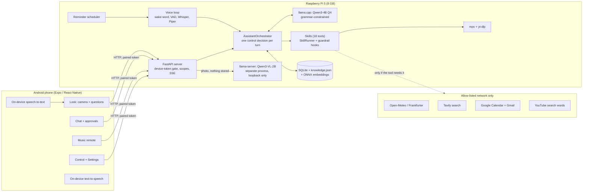
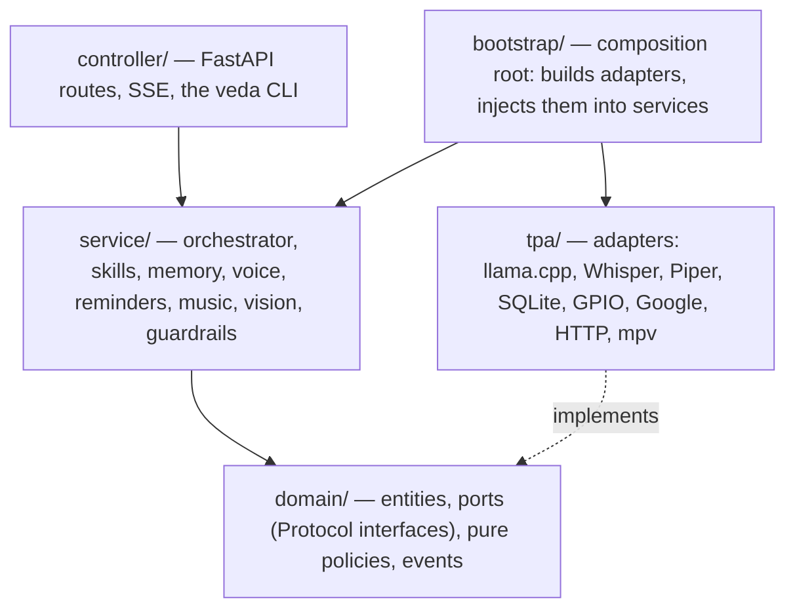
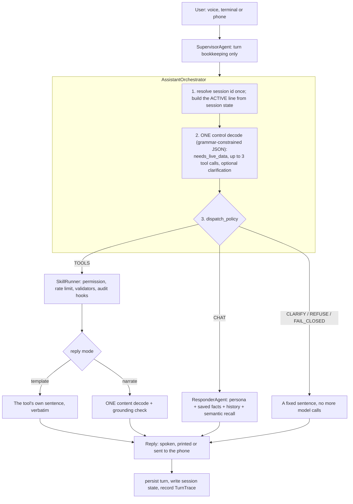
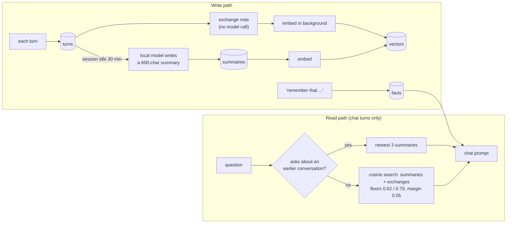
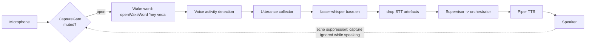

# Vedic Atlas (Veda)

**Veda is a private voice assistant that runs entirely on a Raspberry Pi.** You talk to it, type to it, or use an Android
phone as its remote control and camera. It keeps your lists, reminders and facts, reads your calendar and mail, plays
music, tells you the weather, and describes what your phone camera sees. The language model, the speech recognition,
the voice, the memory and the camera model all run on the device. There is no cloud model, no silent model download,
and every network call is on an explicit allow-list (`src/tpa/online/allowlist.py`).

This README is written for a reviewer who wants the whole picture in one place: what the problem is, how the system is
built, how the main parts work (orchestrator, memory, agents, skills), how it was built session by session, and what is and
is not tested. Numbers come from saved runs or from the commands listed in [Tests and coverage](#tests-and-coverage).
Anything not measured says so.

- [The problem and the constraints](#the-problem-and-the-constraints)
- [What Veda can do today](#what-veda-can-do-today)
- [System architecture](#system-architecture)
- [How one request is handled](#how-one-request-is-handled)
- [The main components](#the-main-components): [orchestrator](#1-the-orchestrator-one-decision-per-turn) ·
  [agents](#2-agents-what-exists-and-what-does-not) · [skills](#3-skills-and-the-tool-list) ·
  [memory](#4-memory) · [safety](#5-safety-privacy-and-access-control) · [voice](#6-the-voice-loop) ·
  [vision](#7-vision-and-the-phone-app) · [music and reminders](#8-music-reminders-and-the-room-sensor)
- [Architecture patterns used](#architecture-patterns-used)
- [How it was built: the sessions](#how-it-was-built-the-sessions)
- [Tests and coverage](#tests-and-coverage)
- [Measured results and honest limits](#measured-results-and-honest-limits)
- [Getting started](#getting-started) · [Phone app](#phone-app) · [More docs](#more-docs)

---

## The problem and the constraints

A voice assistant for a home should work when the internet is down, should not send what you say to a company, and should
not cost a subscription. That rules out the usual design (stream audio to a cloud model) and forces three hard
constraints on this project:

| Constraint | What it forces |
|---|---|
| **All reasoning is local** (no cloud LLM, no silent downloads) | A small quantized model (Qwen3-4B Q4, with 1.7B and 0.6B profiles) running on a CPU. Cloud backends are rejected in code, not just unconfigured (`UnsupportedBackendError`). |
| **A Raspberry Pi is the target** (Pi 5, 8 GB) | Every prompt has a token budget, decoding is constrained so a small model cannot produce malformed output, and slow work (summaries, indexing) runs in the background. |
| **Small models make mistakes** | The model only *picks* a tool and fills one to three flat arguments. Code does the dates, the sentences and the safety checks, and refuses when the model's output does not match what the user actually said. |

The rest of the design follows from those three lines.

## What Veda can do today

| Area | What works | Where |
|---|---|---|
| **Talk or type** | Wake word "hey veda", speech-to-text, spoken replies, a physical mute switch, a terminal chat (`veda`) | `service/voice`, `controller/cli` |
| **Tools (18)** | Weather and forecast, currency, web search, to-do list, saved facts, Gmail (search, read, draft, send), Google Calendar (read, add), clock, volume, apps, battery, music, room temperature | `config/tools/*.yaml` |
| **Memory** | Saved facts, per-session history, session summaries, recall of earlier conversations | `service/memory`, `service/conversation` |
| **Reminders** | "Remind me at 6 pm to call the bank", spoken once at that time, even when the voice loop is off | `service/reminders` |
| **Music** | "Play Tum Hi Ho": found with `yt-dlp`, played with `mpv` on the Pi's speaker; the microphone is closed while it plays | `service/music` |
| **Vision** | Photograph something with the phone; a local Qwen3-VL-2B model on the Pi describes it and answers spoken questions about it | `service/vision`, `tpa/vision` |
| **Phone app** | Android app (Expo / React Native): pair with a code, then Look, Chat with approvals, Music, Control and Settings, over home Wi-Fi | `mobile/` |
| **Setup** | One script provisions a Pi (`scripts/setup_pi.sh`) or a Windows laptop (`scripts/setup_windows.ps1`) | `scripts/` |

Try it: `play Tum Hi Ho` · `remind me at 6 pm to call the bank` · `is it hot in here` · `should I bring an umbrella tomorrow` ·
`remember that my favourite sweet is gulab jamun` · `what is on my calendar today`.

## System architecture

Two devices on the same home Wi-Fi. The Pi does all the work; the phone is a remote, a camera, and the place where
speech is turned into text (so your voice from the phone never leaves the phone).



Inside the Pi the code is a **hexagonal (ports-and-adapters)** layout. Dependencies point inward only:



- `service/` never imports `tpa/`. Every service receives its dependencies as `domain.ports.*` types, so "local llama.cpp
  today, another backend tomorrow" and "laptop microphone today, Pi GPIO tomorrow" are adapter swaps, not rewrites.
- `bootstrap/` is the only place that knows which concrete adapter is used (`src/bootstrap/container.py`).
- The REST API is the one real interface. The `veda` CLI and the phone app are both clients of the same server.
- Hardware differences are one file: `VEDA_DEVICE=laptop|pi` merges `config/hardware/<device>.yaml` over the defaults.

Layer-by-layer detail: [`docs/00-overview.md`](docs/00-overview.md) and `docs/01` to `docs/06`.

## How one request is handled



Model calls per turn: a tool turn with a template reply costs **one** decode; a tool turn that must be phrased costs two;
a chat turn costs two; a clarification or refusal costs one. Full detail: [`docs/08-tool-harness.md`](docs/08-tool-harness.md).

## The main components

### 1. The orchestrator: one decision per turn

`service/agent/assistant_orchestrator.py` replaced an earlier design (keyword rules, then a small router model, then a
per-agent tool decision). That design picked a route from the newest message only, so a follow-up such as "and tomorrow?"
lost its context, and a keyword regex could force a tool the model had correctly declined. The current rules:

1. **One decision per turn, made by the model with the conversation in view.** No regex reads the user's message to choose
   a tool. A regex may only *veto* the model's output.
2. **The model does the minimum**: pick tools and fill flat arguments. Code does dates, place defaults and sentences.
3. **Output is constrained** by a llama.cpp grammar built from the tool manifests: no malformed JSON, no unknown tool.
4. **Facts come only from tool results.** Template tools speak their own sentence; the model never paraphrases a number.
5. **Fail closed.** An unparseable decision becomes "I didn't catch that"; a question needing live data with no tool gets a
   fixed refusal; a destructive call that does not name its target in the user's own words asks "which one?".
6. **One source of truth per tool**: `config/tools/<name>.yaml`.

What the control decode sees each turn: the static persona, every tool and the rules (cached), then `ACTIVE:` (the last
successful tool and its arguments, 15-minute expiry), the last two exchanges of the current session, today's date, and the
user's message. It sees no facts, summaries or memory (see [Memory](#4-memory)).

### 2. Agents: what exists and what does not

An honest account, because the word "agent" appears in the code and the history:

| Piece | Role today |
|---|---|
| `SupervisorAgent` | Entry point for a turn. It no longer routes; it hands every turn to the orchestrator and keeps bookkeeping (`current_agent`, `agent_chain`). |
| `AssistantOrchestrator` | The one decision-maker (above). |
| `ResponderAgent` | The chat path: builds the cache-friendly prompt (persona, saved facts, recalled memories, history), streams the reply, and vets it so it never claims an action that did not happen. |
| `AmbientDispatcher` | Speaks events that nobody asked for (reminders, calendar heads-ups) and mirrors them into history. |
| Specialist agents (system, google, lookup, tasks) | **Removed** in the orchestrator cutover on 2026-10-08. The `agent:` field in each tool manifest is now only a label for grouping. |

There is no multi-agent loop and no agent-to-agent messaging. That was a decision (fewer agents, one place that decides),
backed by measurement: a native `<tool_call>` design scored 26/41, a hybrid 18/41, and the constrained single decode 28/41 on
the same protocol test ([`docs/session-log.md`](docs/session-log.md)).

### 3. Skills and the tool list

A **skill** is a Python class that does one thing; a **manifest** (`config/tools/<name>.yaml`) tells the model it exists and
tells the harness how to treat it. `ManifestSkill` subclasses implement only `run()`. Every call goes through
`SkillRunner`, which fires guardrail hooks before and after (permissions, rate limit, input validation, output
validation, audit log).

| Tool | Does | Reply | Permission | Needs internet | Notes |
|---|---|---|---|---|---|
| `get_weather` | Current weather for a place (home by default) | template | auto | yes (Open-Meteo) | cached 10 min |
| `get_weather_forecast` | 0-6 days ahead; umbrella or coat questions | template | auto | yes | code validates the range |
| `convert_currency` | Amount between two currencies | template | auto | yes (Frankfurter, open.er-api) | cached 1 h |
| `web_search` | News, scores, prices, changing facts | narrated | auto | yes (Tavily) | snippets never enter a control prompt |
| `tasks` | Add, list, complete, delete to-dos; timed reminders | template | notify | no | delete must name its target |
| `remember` | Save, list or forget lasting facts | template | notify | no | refuses passwords, PINs, card numbers |
| `gmail_search` | List recent mail (sender, subject) | template | auto | yes | private: kept out of traces and logs |
| `gmail_read` | Summarise the newest matching mail | narrated | auto | yes | body never enters a control prompt |
| `gmail_draft` | Write an email and save a draft, read it back | template | notify | yes | resolves names from your own mail |
| `gmail_send` | Send the draft just read back (no arguments) | template | notify | yes | destructive: cannot send text composed in the same turn |
| `calendar_agenda` | Today's and the next days' events | template | auto | yes | read-only |
| `calendar_create` | Add one event | template | notify | yes | invites nobody; refuses a past time |
| `current_time` | Time or date from the device clock | template | auto | no | |
| `volume_control` | Get, set, mute, unmute | template | auto | no | |
| `app_control` | Open, close, focus an app | template | notify | no | closing must name the app |
| `device_status` | Battery, busiest processes | template | auto | no | |
| `music_control` | Play a song by name, or stop | template | auto | yes (YouTube) | mic closed while playing |
| `get_room_temperature` | Indoor temperature and humidity | template | auto | no | DHT11 on a Pi, fixed mock values on a laptop |

Two more skills, `terminal` and `file_ops`, exist but are **deliberately not callable by the model**.

**Adding a tool** is four steps: write the manifest; write a `ManifestSkill` with `run()`; register it in
`bootstrap/container.py`; add cases to `tests/eval/orchestrator_golden.yaml`. The static control prompt grows about 100
tokens per tool and has a hard budget (about 2,600 tokens); a test fails if a new tool leaves less than 400 tokens of room.

### 4. Memory

Six stores with different lifetimes, written at different times. Only some reach a prompt. Full detail with sequence
diagrams: [`docs/12-memory-layer.md`](docs/12-memory-layer.md).

| Store | Holds | Lifetime | Reaches a prompt? |
|---|---|---|---|
| **Facts** (`knowledge.json`) | `topic: value` lines, e.g. `favourite sweet: gulab jamun` | Until you say "forget", max 40 | Every chat turn |
| **Turns** (SQLite) | Every user and assistant message, tagged with a session id | 30 days after being summarised | Current session, last few turns |
| **Summaries** (SQLite) | One paragraph per finished session, written by the local model | Kept | Questions about earlier conversations |
| **Vectors** (SQLite) | 384-dim embeddings of facts, summaries and each exchange | Pruned with their source | Semantic recall |
| **Session state** | Last successful tool call and its arguments | 15 minutes | The control decode's `ACTIVE:` line |
| **Agent-memory mesh** | One routing record per turn | 10 days | **No** (written, never read; see limits) |



Design points worth knowing:

- **A session is a conversation with no gap longer than 30 minutes.** The id is resolved once per turn, so a turn cannot land
  in two sessions.
- **Exchange notes are built from the spoken words, with no model call**, because paraphrasing would cost minutes on a Pi and
  could change a detail.
- **The control decode gets no recalled memory**, only the last two exchanges and the `ACTIVE:` line. That keeps the cached prompt
  stable and stops a stored sentence from steering tool choice.
- **Embeddings** are `bge-small-en-v1.5` as a local ONNX file, never downloaded at runtime. Search is a full numpy scan,
  which is fine for hundreds of rows.
- **Similarity thresholds were measured**: ordinary questions have a median score of 0.56; past-tense questions score
  0.66 or more. Memory evaluation (small, self-written test): right summary found 10/12; false memory shown on ordinary questions 4/16
  (the base setup showed it 15/16).

### 5. Safety, privacy and access control

| Layer | What it does | Where |
|---|---|---|
| **Network allow-list** | Only listed hosts can be reached; no redirects; each tool declares its hosts. `privacy.online.enabled: false` removes every online tool. | `tpa/online/allowlist.py`, tool manifests |
| **Write guards** | The model's output is checked against the user's own words: a calendar event needs a time and title the user said; an email needs a body; "cancel my meeting" is refused rather than turned into a new event. | `tests/test_guards.py` |
| **Destructive-call veto** | `delete`, `forget`, `close` and `send` must name their target in the user's words, never from session state or a pronoun. | `domain/policies/destructive_policy.py` |
| **Claims guard** | A reply that says "I've saved that" when nothing was saved is blocked. | `domain/policies/claim_guard_policy.py` |
| **Grounding check** | A narrated answer that states a measurement not present in the tool result is replaced by the plain text. | `domain/policies/grounding_policy.py` |
| **Guardrail hooks** | Pre-skill permission level, rate limit (30/min global, 10/min per skill), input and output validators (PII, credentials), audit log. | `service/guardrails`, `service/hooks`, `config/guardrails.yaml` |
| **Governance engine** | Policy files for tool gating and prompt safety with a circuit breaker and SQLite audit. **Built, off by default** (`config/governance.yaml: enabled: false`). | `service/governance`, `tpa/governance` |
| **Privacy of private tools** | Mail and calendar results are kept out of traces, logs, the audit log and API output. | `private: true` in manifests |
| **Mute** | A physical GPIO switch (BCM 17) overrides software unmute. Mute mid-sentence discards the utterance. Music is stopped by mute. | `service/privacy/capture_gate.py` |
| **Phone access** | One-time pairing code (120 s, single use), per-device token with scopes `chat`, `control`, `vision`, `approve`; revocable. The LAN gate is fail-closed; only loopback is trusted; unknown routes are denied. | `service/devices`, `controller/middleware/device_auth.py` |

### 6. The voice loop

`service/voice/voice_session.py` runs the always-on loop:



Three properties matter more than the happy path: mute is checked on **every frame**; capture is ignored while Veda speaks
(otherwise it transcribes itself and talks in a loop); and replies from voice are kept to one or two sentences.

### 7. Vision and the phone app

Vision is a deliberately **isolated** part of the system: it receives an image, returns text, and forgets.

- Runs in its own `llama-server` process (Qwen3-VL-2B Q4_K_M), bound to loopback, with its own lock, so it cannot stall the main model.
- Imports nothing from memory, conversation or agents, and nothing imports it; an import-boundary test enforces this
  (`tests/test_vision_isolation.py`).
- Photos are held in memory only. Descriptions are not stored in history, vectors or traces. To remember one, the app
  sends it as an ordinary chat message.
- No internet is used on the vision path.

The Android app (`mobile/`, Expo SDK 58 / React Native) pairs with a code, then has five screens: Look, Chat (with approvals
and a microphone), Music, Control and Settings, plus an offline screen when the Pi cannot be reached. Speech-to-text and
text-to-speech run on the phone. Design docs: [`docs/15-vision-mobile-design.md`](docs/15-vision-mobile-design.md),
[`docs/16-mobile-app-design.md`](docs/16-mobile-app-design.md).

### 8. Music, reminders and the room sensor

- **Music**: `MusicService` (states idle, starting, playing, paused) searches YouTube with `yt-dlp` and plays with `mpv` over
  its IPC socket. The microphone stays closed while a song plays, a reminder pauses the song while it is spoken, and a
  song stops after 5 minutes of played time. The phone's Music tab is a remote for it:
  [`docs/17-music-in-the-app.md`](docs/17-music-in-the-app.md). This is the one documented exception to the network
  allow-list (only the search words leave the device).
- **Reminders**: stored as tasks with a time, spoken once, even when the voice loop is off, waiting for a reply or a song to
  pause first. Calendar events also get a 15-minute heads-up.
- **Room sensor**: a DHT11 on the Pi (`sensing.room.driver: auto`); a laptop reports mock values.

## Architecture patterns used

| Pattern | Where it appears | Why |
|---|---|---|
| **Hexagonal / ports and adapters** | `domain/ports` (about 20 `Protocol`s) and `tpa/` adapters | Swap models, audio and hardware without touching services |
| **Composition root** | `src/bootstrap/container.py` | One place decides concrete adapters; services stay testable |
| **Layered with an inward dependency rule** | controller -> service -> domain <- tpa | Business rules do not depend on frameworks |
| **Pure policy functions** | `domain/policies/*` (dispatch, destructive, grounding, claims, retention, session boundary) | Rules are small, deterministic and unit-testable without a model |
| **Manifest-driven tools** | `config/tools/*.yaml` -> `ManifestSkill` | One source of truth for the prompt, the grammar, permissions and reply mode |
| **Constrained decoding** | Grammar built from manifests (`build_control_schema`) | A small model cannot emit invalid output |
| **Template replies** | `reply_mode: template` | Numbers and names come from tools, never from model text |
| **Fail-closed** | Unparseable, ungrounded, unnamed-target and unauthorised cases | A wrong refusal is cheaper than a wrong action |
| **Hooks / interceptors** | `SkillRunner` + `HookRegistry` (pre_skill, post_skill, on_error) | Permissions, rate limits and audit are not repeated in each skill |
| **Decorator chain for resilience** | `SingleFlight(GracefulDegradation(LlamaCppClient))` | Serialise CPU-bound calls, retry once, optionally fall back |
| **Event / observer for indexing** | `on_exchange`, `on_summary`, `on_change` callbacks into `MemoryIndexer` | Memory stays out of the reply's critical path |
| **Process isolation** | Vision in a separate `llama-server` | Failure and memory pressure stay contained |
| **Capability scopes** | Device tokens with `chat`, `control`, `vision`, `approve`; default-deny route table | Least privilege for each paired phone |
| **State machine** | `MusicService` and the mobile `connectionStore` phases | Explicit states instead of flags |

## How it was built: the sessions

The project was built over about four weeks by a small team, in working sessions. Each row is one session; dates come from
the git history, results from the stage files in `docs/stages/` and the saved runs in `tests/eval/results/`.

| Session | Date | What was done | Outcome |
|---|---|---|---|
| 1. Skeleton | Oct 1-2 | Folder structure, domain layer, ports, exceptions, schemas, tpa adapters, guardrails, hooks, governance, voice, tests | Hexagonal layout in place |
| 2. Tool harness | Oct 3-4 | Manifest-driven tools: weather, currency, web search; wake word; mute interrupt; Pi setup script; `remember`; semantic memory | First working assistant |
| 3. Small-model profiles | Oct 6 | 1.7B and 0.6B profiles, trimmed chat prompts, model-based routing | Replies in 6-8 s on CPU |
| 4. Unified orchestrator | Oct 7-8 | Phases 0 to 6: control decode, session state, dispatch policy, deleted the keyword router and specialist agents | Stage 1: golden 43/51 (84%), held-out 28/40 (70%), but ~14.6 s per decision |
| 5. Google, reminders, guards | Oct 8-9 | Gmail and Calendar tools, `veda login`, reminders, clock, write guards | Golden 46/57, held-out 36/46; prompt full (2,597 of 2,600 tokens) |
| 6. Memory and recall | Oct 9-10 | Summaries, exchange index, semantic recall, intent routing | Right summary 10/12; false memory 4/16 |
| 7. Model choice and fine-tune | Oct 9 | 4B 58/70, 1.7B 35/70, 0.6B 19/70 on golden; trained a 1.7B router (A100, LoRA, 49 min) | On an unseen 346-case set: base 37.9% -> tuned Q4 78.9%, Q5 81.2% (not shipped) |
| 8. Prompt patch attempt | Oct 9 | Edited the prompt to fix misses | Got worse (golden 55/70), reverted; place guard kept |
| 9. Refactor and Pi tuning | Oct 23-24 | Composition root moved to `bootstrap/`; adaptive reply, parallel tool calls, timed reminders | Cleaner wiring |
| 10. Music, spoken reminders, room sensor | Oct 25 | `MusicService`, mpv/yt-dlp, spoken reminders, DHT11, automated setup scripts | Verified on a laptop |
| 11. Vision and phone app | Oct 25 | Device pairing, LAN gate, local vision model, the Android app | Verified on a real phone over Wi-Fi |
| 12. Phone UX and Music tab | Oct 26 | Tab bar from the design canvas, chat microphone, offline screen, Music tab, duplicate-server guard, Pi vision download | Music verified on the laptop |
| 13. First Pi run | Oct 27-28 | Pi performance (half the memory, cached prompts, no speaker stall), apt hook workaround, vision beside the main model | In progress: Pi measurements still to be taken |

Per-stage metrics and reasons for each decision: [`docs/stages/00-summary.md`](docs/stages/00-summary.md) (and files `01` to `11`).
The working log of the orchestrator redesign: [`docs/session-log.md`](docs/session-log.md).

## Tests and coverage

Measured on 2026-10-28 on the development laptop (Windows, Python 3.12), on `main` at the commit that adds this section.

| Suite | Command | Result |
|---|---|---|
| **Backend** (Python, `tests/`) | `pytest -q --ignore=tests/test_vector_store.py --ignore=tests/eval --cov=src` | **1,184 passed, 6 skipped, 1 failed** in 3 min 7 s. **67% line coverage** (14,902 statements, 4,903 not run) |
| **Phone app** (Jest, `mobile/`) | `cd mobile && npx jest --coverage` | **744 passed, 0 failed** in 39 suites. Statements 92%, branches 85%, functions 89%, lines 96% (of the files the tests import) |

How to read these numbers honestly:

- **The one failing backend test** is `tests/test_music.py::test_the_song_waits_until_veda_has_stopped_talking_and_a_new_request_replaces_the_old_song`.
  It fails on the music code as the teammate branch delivered it, not on later changes. It is not fixed yet.
- **The phone-app contract tests** start the real Pi routes (`scripts/mock_pi.py`) and call them from the app's client, so the
  wire format between the app and the Pi is tested on both sides. When this suite ran at the same time as the backend
  suite, two UI tests timed out (5 s limit under load); they pass when run alone.
- **Phone-app coverage only counts files that a test imports.** A screen no test opens is not in the percentage.
- **`tests/test_vector_store.py` is excluded** by the project's standard test command (see below), and so is `tests/eval/`
  (model evals). A few vision tests load the real model and only pass when the machine has about 1.5 to 2 GB of free RAM.
- **Coverage is line coverage, not proof of correctness.** It shows which code the tests executed.

### Where the backend coverage is high, and where it is low

| Area | Statements | Covered | What this means |
|---|---|---|---|
| `domain/policies` (the pure rules) | 875 | **97%** | Dispatch, destructive-call veto, grounding, claims, retention are the most tested code, by design |
| `schemas`, `service/prompting`, `service/vision`, `service/session`, `service/devices` | 1,000+ | 96-100% | |
| `service/agent` (orchestrator, decoder, responder) | 794 | 87% | Tested with scripted model output (`test_orchestrator_golden.py`) |
| `service/lookup`, `service/music`, `service/reminders`, `tpa/online`, `tpa/vision` | 1,600+ | 89-94% | |
| `service/skills` | 893 | 79% | |
| `service/voice` | 666 | 72% | The loop's decisions are tested; real microphones are not |
| `service/memory`, `service/conversation` | 505 | 64-72% | Summariser is only 34%: it needs a model call, so it is checked on the real model, not in unit tests |
| `service/guardrails`, `service/hooks`, `service/governance` | 445 | **26-39%** | **Built and wired but thinly tested** (governance is off by default) |
| `controller/cli` | 1,517 | **34%** | The terminal REPL and commands are exercised by hand |
| `bootstrap` (composition root) | 909 | **29%** | Covered by one isolated smoke test, not line by line |
| `tpa/inference`, `tpa/system`, `tpa/hardware`, `tpa/speaker`, `tpa/wake_word`, `tpa/notifications` | 1,500+ | **0-22%** | Adapters to real models, the OS and hardware: they need the real thing, so they are verified by running Veda, not by unit tests |

### Model-accuracy evaluation (separate from unit tests)

The tool-choice accuracy of the model is measured with the evals in `tests/eval/` and `scripts/spike_decision_protocol.py`,
using the real model (about 45 minutes; `powershell scripts\run_regression.ps1 -Tag mycheck`):

- `orchestrator_golden.yaml` (tuned against) and `orchestrator_heldout.yaml` (never tuned against), plus `orchestrator_edge.yaml`.
- Qwen3-4B base: golden about 84%, held-out 70-78%. Qwen3-1.7B base: 50% / 54%. Fine-tuned 1.7B router: 78.9% (Q4) and
  81.2% (Q5) on an unseen 346-case set, against 37.9% for the base; not shipped yet.
- Full numbers and what failed: [`docs/stages/00-summary.md`](docs/stages/00-summary.md).

## Measured results and honest limits

**Verified:** the full unit and contract suites above; the phone app on a real Android phone over home Wi-Fi (pairing, Look
including questions by voice, Chat with approvals, Control, Settings); music on a laptop (search, play, pause, stop,
5-minute limit, phone remote); the laptop voice loop.

**Not yet measured or verified (do not assume these work):**

1. **Everything on the Raspberry Pi under load.** RAM with both models loaded, photo latency, voice stutter, and CPU temperature
   are still to be measured. A tool decision took about 3 s (tuned 1.7B) to 13 s (4B) on a laptop CPU; a Pi will be slower.
2. **Music on the Pi**: `mpv` pause and the Bluetooth speaker have not been verified there. The Pi's `yt-dlp` may be too old
   for YouTube; the version installed by `pip` in the project environment is the one Veda should use.
3. **Tuned router**: the fine-tuned 1.7B model is not part of the shipped setup; the first Pi run uses the untuned base model.
4. **Accuracy gate not cleared**: a 4B Q4 model picks the right tool about 84% of the time on the tuned set and about 70% on the
   held-out set. Typical misses: general knowledge sent to `web_search`, a two-intent message dropping the second call.
5. **Phone UI**: the on-screen keyboard still covers "Add a task" (Control) and "Change address" (Settings). Several design details
   (font, voice picker, TalkBack switch) do not match the design canvas yet.
6. **Not ready for the Play Store**: plain HTTP on the LAN, no privacy policy, no in-app reporting of AI content. It is a
   sideloaded prototype.

**Known design gaps** (from [`docs/12-memory-layer.md`](docs/12-memory-layer.md) section 7):

- The agent-memory mesh is written every turn but no prompt reads it (the model once mistook the routing rows for tasks).
- `knowledge.json` is not written atomically: a power cut mid-write on the Pi could lose all facts.
- `POST /knowledge` skips the skill's sensitive-data screen and the 40-fact cap.
- Summarising holds the single inference lock, so replies wait while it runs (minutes on a Pi).
- The Pi's microphone can hear the phone speaking a description aloud, and that could reach conversation history.
- Any change to `control_stage.md` or a tool description means rebuilding the training data and retraining the tuned router.

## Folder Structure

```
vedic-atlas/
├── config/                  # settings and run profiles
├── data/
├── docs/                    # architecture, layer docs, handoff, plans
├── mobile/                  # Android phone app (Expo / React Native)
├── scripts/                 # includes mock_pi.py, a stand-in Pi for app development
├── server.py                # ASGI entry point (uvicorn server:app)
├── src/
│   ├── bootstrap/           # composition root: wires adapters, builds the FastAPI app
│   ├── controller/          # CLI + REST routes
│   ├── core/                # config, constants, logging
│   ├── domain/              # entities, ports, pure policies
│   ├── exceptions/
│   ├── schemas/
│   ├── service/             # agents, skills, governance, memory, voice, mail, reminders
│   ├── tpa/                 # adapters: audio, stt, tts, inference, wake_word, online, ...
│   └── utilities/
├── tests/                   # unit tests and eval harness
├── training/                # router fine-tuning pipeline (see training/README.md)
├── wakeword_training/
├── .env.example
├── LICENSE
├── pyproject.toml
├── run.bat
└── run.sh
```
## Getting Started

### 1. First-time setup (run once after cloning)

One script per platform installs everything Veda needs, downloads the models, and checks the result. Both are safe to
re-run: each step skips work that is already done.

| | Windows laptop | Raspberry Pi (64-bit Raspberry Pi OS) |
|---|---|---|
| Run | `powershell -ExecutionPolicy Bypass -File scripts\setup_windows.ps1` | `bash scripts/setup_pi.sh` |
| Options | `-DryRun`, `-Model 0.6b\|1.7b\|4b`, `-SkipModels`, `-SkipMpv`, `-SkipLlamaRebuild` | `--dry-run`, `--model 0.6b\|1.7b\|4b`, `--skip-apt`, `--skip-models`, `--skip-hardware` |

What the scripts install, so nothing is left to run by hand:

| Part | Windows (`setup_windows.ps1`) | Raspberry Pi (`setup_pi.sh`) |
|---|---|---|
| Python environment `.venv` + `pip install -e .` | yes (needs Python 3.12+) | yes |
| Language-model library `llama-cpp-python` | **built with AVX2/FMA** if Visual Studio Build Tools are present (otherwise the generic wheel, which is 3-6x slower, with the one-line fix printed) | compiled natively by pip (10-30 min) |
| Models in `data/` (language model, speech-to-text, memory) | downloaded, resumable | downloaded, resumable, plus the Piper voice |
| Wake-word helper files (inside the `openwakeword` package) | downloaded | downloaded |
| **Music**: `yt-dlp` (finds the song) | installed by `pip install -e .` | installed by `pip install -e .` |
| **Music**: `mpv` (plays it) | `winget install shinchiro.mpv` | `apt install mpv` |
| **Reminders** (spoken) | nothing extra: they use the same voice as replies | nothing extra |
| **Room temperature**: DHT11 libraries | not needed (mock sensor) | GPIO + DHT11 libraries, best effort |
| Bluetooth tools | not needed | `apt install bluez` |
| `.env` from `.env.example` | yes | yes |

Then there is no configuration to switch on: music turns itself on when `mpv` and `yt-dlp` are both found (and
`privacy.online.enabled` is true), the room sensor uses the real DHT11 only when its library is installed
(`sensing.room.driver: auto`), and `veda` logs what it found or is missing at startup.

**What you still do by hand (these cannot be automated):**

1. Copy your trained wake-word model into `data/models/openwakeword/`: `hey_veda.onnx` **and** `hey_veda.onnx.data`.
   Until it is there the voice loop stays off on purpose (typing still works: chat, reminders, music).
2. Put your keys in `.env`: `TAVILY_API_KEY` for web search; for mail and calendar the Google client id/secret, then run
   `veda login` once (`veda login --manual` on a Pi without a browser).
3. **Raspberry Pi only:** pair the Bluetooth speaker once (`bluetoothctl`: `scan on`, `pair <MAC>`, `trust <MAC>`,
   `connect <MAC>`) and make it the default output; wire the mute switch (`privacy.mute_gpio_pin`, default BCM 17) and the
   DHT11 data pin (`sensing.room.gpio_pin`, default BCM 4).
4. A non-default model needs its profile, e.g. `VEDA_PROFILE=qwen3-1.7b` in `.env` (the 4B model needs none).

### 2. Run

`run.bat` (Windows) and `./run.sh` (Linux/macOS) start the `veda` CLI. With no arguments it opens the REPL and starts
the local server (the voice loop runs inside it) if one is not already running. `veda server` runs the server on its own.
The microphone starts muted: type `/unmute`. `/mute` closes it again (and stops any music).

Try: `play Tum Hi Ho` - `remind me at 6 pm to call the bank` - `is it hot in here` - `should I bring an umbrella tomorrow`.

### 3. Music, reminders and the room sensor (what to expect)

- **Music** (`config/music.yaml`): songs are found on YouTube with `yt-dlp` and played with `mpv`. This is the one
  documented exception to the network allow-list (only the search words leave the device). While a song plays the
  microphone is closed; the mute switch, `/mute` and `/unmute` stop it, and it also stops when it ends or after 5 minutes.
- **Reminders**: "remind me at 6 pm to ..." stores a task with a time and speaks it once, at that time (calendar events
  also get a 15-minute heads-up). They are spoken even when the voice loop is off, and wait for a reply or a song to
  pause first.
- **Room temperature** (`config/sensing.yaml`): "is it hot in here" reads the DHT11 on the Pi; a laptop reports the fixed
  mock values (28 C, 55%).

### 4. Tests and checks

```
pytest -q --ignore=tests/test_vector_store.py            # unit tests, no model needed (about 30 s)
powershell scripts\run_regression.ps1 -Tag mycheck       # unit tests + the router evals on the real model (about 45 min)
```

`pytest` is installed with `pip install -e .[dev]`. Stop the Veda server before running the evals: they load their own
copy of the model.

## Phone app

The app talks to the Pi's HTTP API over your home network (plain HTTP, no cloud). English
only and Android only for now. It is a working prototype for sideloading, **not** ready
for the Play Store (it still needs HTTPS or a documented local-network story, a privacy
policy and in-app reporting for AI content).

### Set up a Raspberry Pi
`bash scripts/setup_pi.sh` installs everything, including the phone camera model: the ARM
`llama-server` build and Qwen3-VL-2B (about 1.5 GB, checked with SHA-256; skip with
`--skip-vision`). It adds `VEDA_DEVICE=pi` to `.env`, which loads `config/hardware/pi.yaml`
(the Pi's vision settings, and listening for paired phones).

### Use it from a phone (same home Wi-Fi)
On the Pi:
```
veda                # start Veda and open the chat prompt (joins it if it is already running)
veda --restart      # stop the running Veda and start a fresh one
veda pair           # print a one-time code and QR; enter it in the app
veda devices        # list paired phones; `veda devices revoke <id>` removes one
```
Talk to it by voice at the Pi, or type at the prompt, or use the phone for Look, Chat and
Control. A physical mute switch on the Pi's mic leaves the terminal and the phone working.

On a laptop (no hardware profile) a server started by `veda` listens on this machine only,
so a phone cannot reach it. Start it with `veda server --lan` first, then `veda pair`.

Run only one Veda server: each loads every model again. `veda server` refuses to start a
second one (it names the process already running).

### Develop the app without a Pi
`scripts/mock_pi.py` serves the real routes, pairing and permission gate with a scripted
vision model and canned chat replies:

```
vedic-atlas-env/Scripts/python.exe scripts/mock_pi.py --host 0.0.0.0
```

```
cd mobile
npm ci
npm run check        # typecheck, lint and all tests (unit + contract against the mock Pi)
npm start            # Expo dev server
```

The Android release build on Windows needs a short build path and JDK 17:
`powershell -File mobile/scripts/build-android.ps1 -Variant release`
(the script explains why). The APK is written to `mobile/apk/` and is not committed.

### Status
Verified on a real phone over home Wi-Fi: pairing, Look (including questions by voice),
Chat with approvals, Control and Settings. Speech-to-text runs on the phone; the first time,
the phone must download its offline English speech pack once (the app offers a button for it,
over Wi-Fi; your voice is never sent anywhere). Still to do: the polish stage (visual design,
TalkBack, tablet widths) and measuring RAM with both models loaded on a Pi 5 (8 GB).

## More Docs

Vision and phone app:
- [`docs/15-vision-mobile-design.md`](docs/15-vision-mobile-design.md): the Pi side: pairing, access scopes, the vision service and its memory guard
- [`docs/16-mobile-app-design.md`](docs/16-mobile-app-design.md): the Android app: screens, UX, stages, build notes
- [`docs/17-music-in-the-app.md`](docs/17-music-in-the-app.md): the Music tab: Pi routes, rules (mic closed while playing), screens

Core:
- [`docs/00-overview.md`](docs/00-overview.md): architecture overview, with the per-layer docs `01` to `06` beside it
- [`docs/08-tool-harness.md`](docs/08-tool-harness.md): the tool harness
- [`docs/12-memory-layer.md`](docs/12-memory-layer.md): the memory layer end to end, with write and read paths
- [`docs/stages/00-summary.md`](docs/stages/00-summary.md): the stage-by-stage path with metrics (stage files `01` to `11` beside it)
- [`docs/session-log.md`](docs/session-log.md) and [`docs/10-orchestrator-review-and-plan.md`](docs/10-orchestrator-review-and-plan.md): the orchestrator redesign and its measurements
- [`docs/HANDOFF.md`](docs/HANDOFF.md): setting up on another machine, first-run checklist
- [`training/README.md`](training/README.md): router training pipeline
