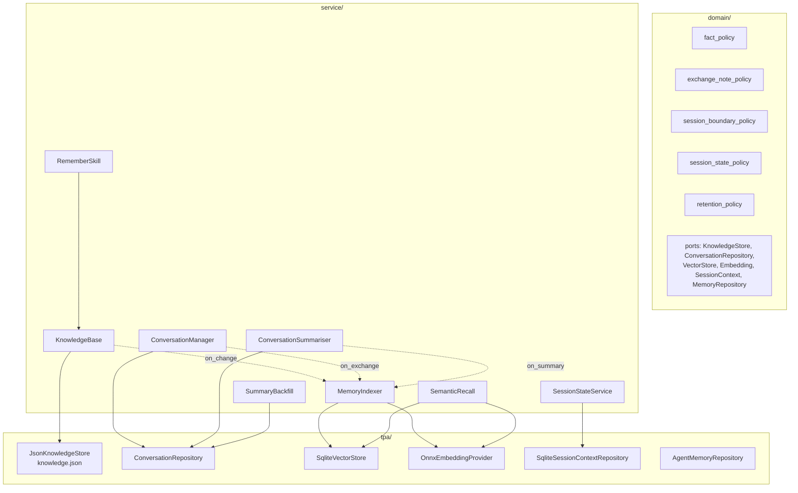
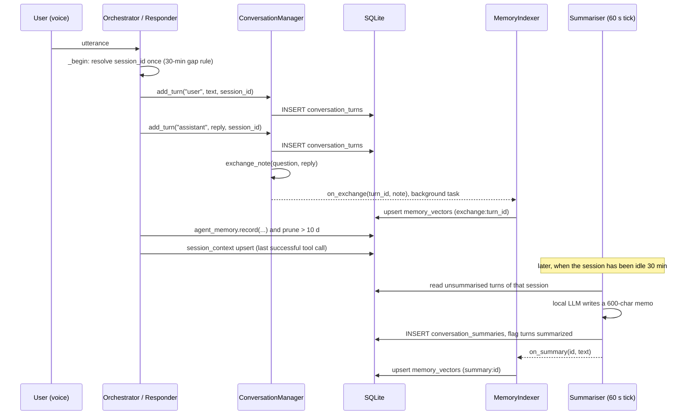
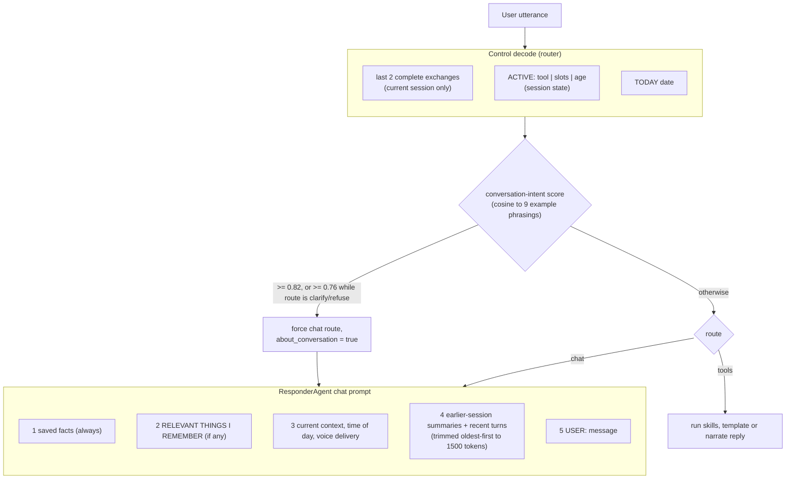

# Memory layer: how it works end to end

Status: describes the code as read on 2026-10-10. It was not run; everything here comes from reading the source.

Veda's memory is six stores with different lifetimes. They are written at different times, and only some of them reach a prompt.

---

## 1. The stores

| Store | Location | Holds | Lifetime |
|---|---|---|---|
| **Facts** | `data/knowledge.json` (`JsonKnowledgeStore`) | `topic: value` lines, e.g. `favourite sweet: gulab jamun` | Never expire (ADR-006). Removed by "forget X" or `DELETE /knowledge/{i}`. Cap 40. |
| **Turns** | SQLite `conversation_turns` | Every user and assistant message, with `session_id` and a `summarized` flag | Deleted 30 days after being summarised. |
| **Summaries** | SQLite `conversation_summaries` | One paragraph per finished session | Never deleted. |
| **Vectors** | SQLite `memory_vectors` | 384-dim float32 BLOB + text, unique on `(source, ref_id, model_id)`; source is `fact`, `summary` or `exchange` | Exchange vectors pruned at boot when their turn is gone. Others see §7. |
| **Session state** | SQLite `session_context` | Last successful tool call and its arguments | 900 s TTL; lazy-deleted on read, purged hourly. |
| **Agent-memory mesh** | SQLite `agent_memory` | One routing record per turn (agent, action, user message) | 10 days, pruned on every write. |

Embedding model: `BAAI/bge-small-en-v1.5`, local ONNX at `data/bge-small-en-v1.5/` (`model.onnx` and `tokenizer.json`). It is staged, never downloaded at runtime.

---

## 2. Architecture

Layers follow the repo convention: domain (ports and pure policies), service (use cases), tpa (adapters).

All of it is wired once in `build_app_state()` in `src/bootstrap/container.py`. The lifespan then starts the background jobs.

---

## 3. Write path

### 3.1 Sessions
`ConversationRepository.current_session_id()` looks at the last turn. If it is at most 30 minutes old (`DEFAULT_SESSION_GAP_MIN`), that session continues. Otherwise it mints a new 8-character id. No placeholder row is written. The orchestrator resolves the id once per turn and passes it to every write, so a turn that straddles the boundary can't land in two sessions.

### 3.2 Turns
- Tool path: `AssistantOrchestrator._persist` saves the user and assistant turns.
- Chat path: `ResponderAgent.on_completion` saves them after stripping filler sentences and vetting the reply for unbacked action claims.
- Ambient notification summaries are mirrored into history as assistant turns by `AmbientDispatcher`.
- `add_turn` swallows persistence errors (logged), so a database hiccup never kills a reply.

### 3.3 Exchange notes
When an assistant turn closes a pending user turn in the same session, `exchange_note` builds `You: <≤110 chars> | Veda: <≤170 chars>`. It is built from the spoken words with no model call, because a paraphrase would cost minutes on a Pi and could get a detail wrong. It returns nothing if either side is under 6 characters. The note is embedded in the background, keyed by the assistant turn's id.

### 3.4 Facts (the `remember` tool)
`RememberSkill` has three actions: `save`, `forget` and `list`.
- **Normalisation.** `normalise_topic` lower-cases, unifies fav/favorite/favourite, and drops filler words (`my the our most a an of`). A new value for the same topic replaces the old one.
- **Limits.** Topic at most 60 chars, value at most 200, at most 40 facts. A full list is refused only for a new topic.
- **Sensitive data.** `is_sensitive` rejects passwords, PIN, OTP, CVV, card or account numbers, Aadhaar, SSN, API key and token.
- **Replies.** The spoken reply is a template built from what was actually stored (new, already saved, or updated from X to Y).
- **After a change.** `KnowledgeBase._notify` fires, which re-indexes all fact vectors in the background.

### 3.5 Summarising
`ConversationSummariser._pick_eligible_session`:
- the session's last turn is at least 30 minutes old, or
- it has 50 or more unsummarised turns and has been idle at least 2 minutes (so it never runs mid-conversation).

It then makes one model call (256 tokens, 180 s timeout) with the system prompt asking for a one-paragraph, third-person, past-tense memo that keeps preferences, decisions, action items and technical facts. On success it writes the summary, flags the turns, and fires `on_summary` to index it. On failure it counts a retry. After 3 failures a session is skipped until restart.

The summariser takes the same single inference lock as the main model, so a summary run blocks replies for as long as it takes.

### 3.6 Cleanup jobs
| Job | Cadence | Effect |
|---|---|---|
| Summariser GC | hourly | Deletes summarised turns older than 30 days. Skipped while any session has failed summaries. |
| Housekeeping loop | hourly | Purges completed tasks (7 d), turn traces (14 d) and expired session state. |
| Agent-memory prune | on every `record()` | Deletes rows older than 10 days. |

---

## 4. Read path

### 4.1 Control prompt gets no recall
The router sees only the last 2 exchanges (`control_history_exchanges: 2`, whole pairs only), the `ACTIVE:` line, and today's date. Facts, summaries and vectors are never in it. The `ACTIVE:` line is how "and tomorrow?" inherits the place from the previous weather call.

### 4.2 Session state
- Written only after a successful tool call. Only the last successful call of the turn is stored.
- Destructive calls (e.g. delete, send) write nothing.
- Empty arguments are dropped.
- Format: `ACTIVE: get_weather | place=Tokyo | 3 min ago`, each slot value clipped to 60 chars.
- It expires after 900 s and is deleted lazily on read.

### 4.3 Semantic recall (chat path only)
`ResponderAgent._prepare_semantic_context`:
1. **Conversation questions.** If the router set `about_conversation`, or the question's cosine similarity to the example phrasings is at least 0.82, the answer comes from `recent_summaries_block`. That is the newest 3 earlier-conversation summaries, newest first, each dated and capped at 280 chars, 800 chars total. The live session's own summary is excluded because its raw turns are already shown.
2. **Otherwise** it embeds the question and searches. Sources are `summary` and `exchange`. Facts are not searched, because they are always in the prompt.
3. **Similarity floors.** At least 0.62 in general and 0.70 for exchanges. These were measured: ordinary questions have a median of 0.56, and past-tense questions score 0.66 or more.
4. **Each source is searched separately and merged**, so the stricter exchange floor can't let exchanges crowd summaries out of the top few.
5. **Top hits.** Up to `top_k = 4`, and only hits within `margin = 0.05` of the best.
6. **De-duplication.** Exchanges already in the visible recent history are dropped.
7. **Short follow-ups.** For a message of 6 words or fewer that found nothing, it retries with the previous user message prepended.
8. **Block format.** Headed `RELEVANT THINGS I REMEMBER:`, each hit capped at 280 chars and the block at 800. Hits are dated with a day label and shown newest first.

Recall is a no-op if the embedding model is missing. It then falls back to recent history only.

### 4.4 Facts block
`JsonKnowledgeStore.get_context()` renders every fact as "the user's <fact>" under a heading that says these are the user's facts and should be mentioned only when relevant. Facts are in the prompt on every chat turn, which is why they are capped at 40.

### 4.5 History block
- `max_history` turns of the current session, each clipped to 200 chars.
- Plus `chat_summaries` earlier-session summaries, oldest first.
- Trimmed oldest-first until the assembled prompt fits `budgets.chat` (1500 tokens).

Profiles:
| Config | `max_history` | `chat_summaries` |
|---|---|---|
| base (`app.yaml`) | 30 | 3 |
| qwen3-0.6b, 1.7b, 4b, router-q4, router-q5 | 4 | 0 |

The small profiles turn the summaries block off to save prefill time. Semantic recall still runs.

---

## 5. Embeddings and search

- **Provider.** `OnnxEmbeddingProvider` uses onnxruntime and tokenizers directly (no fastembed, to avoid extra native wheels on the Pi). It takes the first-token hidden state, L2-normalises it, truncates to 512 tokens, and runs on 2 threads in `asyncio.to_thread`.
- **Store.** `SqliteVectorStore.search` loads all rows for the current `model_id` and sources, stacks them into one matrix, and ranks by cosine in a single numpy product. This is a full scan, which is fine for hundreds of rows. The code notes sqlite-vec as the swap if it ever grows.
- **Model changes.** Rows are filtered by `model_id`, so a new model never mixes incompatible vectors.

Key config (`config/embedding.yaml`):

| Key | Value |
|---|---|
| `top_k` | 4 |
| `min_score` | 0.62 |
| `min_score_by_source.exchange` | 0.70 |
| `margin` | 0.05 |
| `conversation_intent_min` | 0.82 |
| `conversation_intent_soft_min` | 0.76 |
| `max_hit_chars` / `max_total_chars` | 280 / 800 |
| `sources` | summary, exchange |

---

## 6. Boot sequence

1. `init_tables()` creates tables, including `memory_vectors`, `session_context` and `agent_memory`.
2. `build_app_state()` builds the embedding provider (a warning and recall off if the model folder is missing), vector store, indexer, conversation manager, summariser, knowledge base, session state, recall and responder.
3. The lifespan starts the summariser and the hourly housekeeping loop.
4. A background `_backfill_memory_index` task:
   - clears and re-embeds all facts;
   - embeds any summary that has no vector;
   - indexes exchanges that have no vector;
   - deletes exchange vectors whose turn no longer exists.

Repair tool: `scripts/backfill_summaries.py` (dry run by default, `--apply` to write).
- It targets sessions whose turns are flagged `summarized` but whose summary rows are gone.
- It backs up `veda.db` first.
- It writes one dated summary per about 12 turns, using explicit dates instead of "yesterday".
- It writes each session all-or-nothing, and it is safe to run twice.

---

## 7. Known gaps and quirks

1. **The agent-memory mesh isn't read by any prompt.** `agent_memory` is written every turn and pruned at 10 days. The responder deliberately doesn't read it, because the model mistook the internal routing rows for user tasks. `CrossAgentContext` and `BaseLLMAgent._memory_context` exist, but nothing calls them.
2. **Summary dates after downtime.** The live summariser stamps `created_at = now`. If the server was off when a session ended, the summary is dated at the next boot and the day label can be wrong. Only the backfill dates by the conversation.
3. **Summary vectors are never pruned.** Exchange vectors are cleaned at boot, but nothing removes summary vectors whose summary row is gone. (Summaries themselves are never deleted, so this only matters after a manual wipe.)
4. **`knowledge.json` writes aren't atomic.** `_save` opens the file with `"w"`, so a power cut mid-write on the Pi can lose all facts. Writing to a temp file and renaming would fix it.
5. **`POST /knowledge` bypasses the skill's guards.** It calls `kb.add_fact` directly, so the sensitive-data screen and the 40-fact cap don't apply to it.
6. **`DELETE /knowledge/{index}` is positional.** The list can shift between listing and deleting.
7. **Summarising blocks replies.** It holds the single inference lock for as long as the model takes, which can be minutes on the Pi.
8. **Fact reindex clears all fact vectors on every change.** Fine at 40 facts. Facts aren't searched by default anyway, because they are always in the prompt.

---

## 8. File map

| Concern | Files |
|---|---|
| Fact rules | `src/domain/policies/fact_policy.py`, `retention_policy.py` |
| Fact use case and storage | `src/service/memory/knowledge_base.py`, `src/tpa/filestore/json_knowledge_store.py`, `src/service/skills/builtin/remember.py`, `config/tools/remember.yaml` |
| Turns and sessions | `src/service/conversation/conversation_manager.py`, `src/tpa/persistence/repositories/conversation_repository.py`, `src/domain/policies/session_boundary_policy.py` |
| Exchange notes | `src/domain/policies/exchange_note_policy.py` |
| Summaries | `src/service/conversation/summariser.py`, `backfill.py`, `scripts/backfill_summaries.py` |
| Vectors and recall | `src/service/memory/memory_indexer.py`, `semantic_recall.py`, `src/tpa/persistence/vector_store.py`, `src/tpa/inference/embedding_adapter.py`, `config/embedding.yaml` |
| Session state | `src/domain/policies/session_state_policy.py`, `src/service/session/session_state.py`, `src/tpa/persistence/repositories/session_context_repository.py` |
| Agent-memory mesh | `src/tpa/persistence/repositories/agent_memory_repository.py`, `src/service/memory/cross_agent_context.py`, `record.py` |
| Consumers | `src/service/agent/responder.py`, `assistant_orchestrator.py`, `src/service/prompting/prompt_composer.py` |
| Wiring | `src/bootstrap/` (`container.build_app_state`, `background.backfill_memory_index`, `background.index_exchanges`, `lifespan`) |
