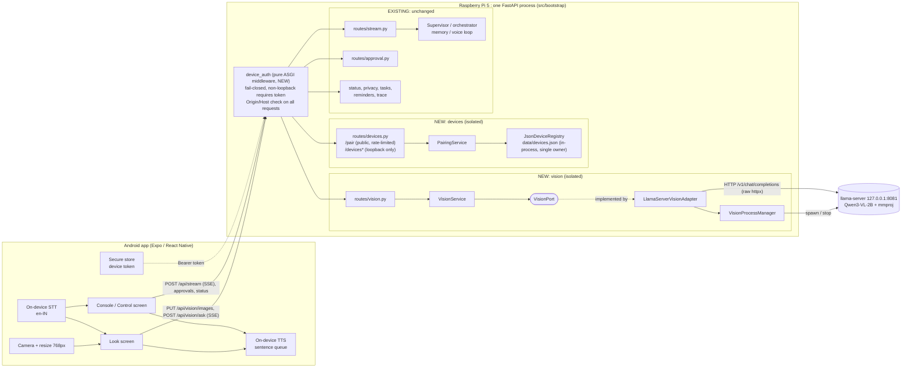
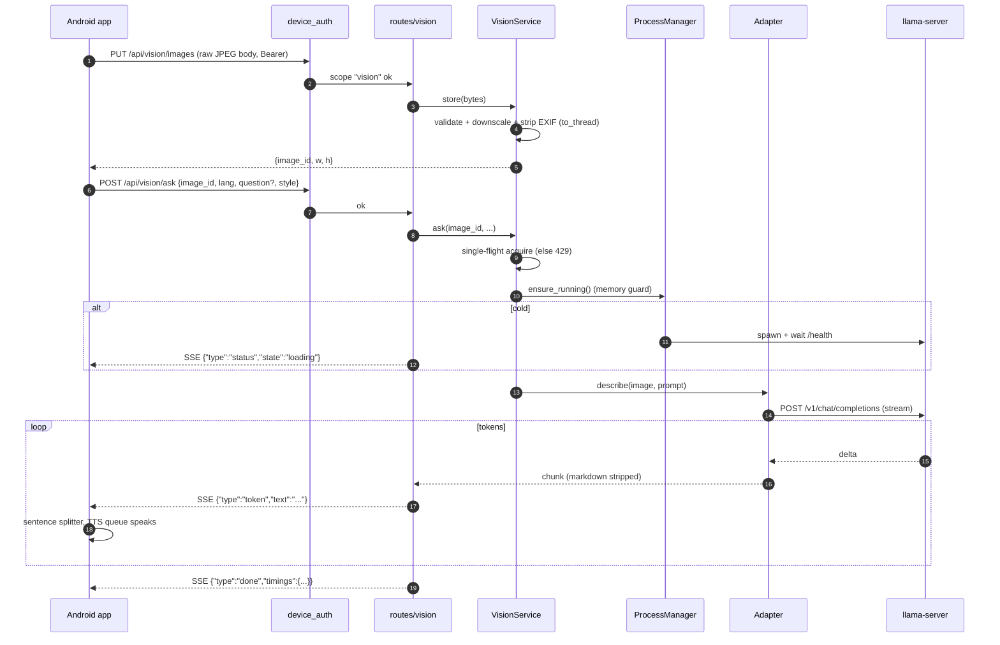
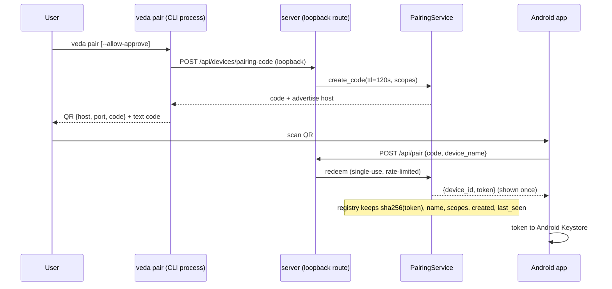
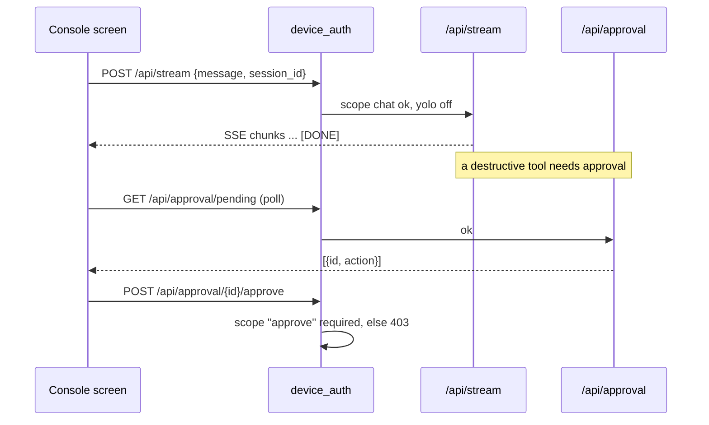

# 15 — Vision Companion: phone camera → Pi vision model → spoken description

Status: **design v3. M2 (devices, pairing, auth gate) and M3 (vision on the laptop) are implemented and tested, and work end to end from a real phone over Wi-Fi (see 12.1, 12.2). Not yet done: RAM measurements with both models on the Pi 5, and the Pi run itself.** v3 incorporates an independent review (Claude Opus)
checked against the code; §16 lists what changed and why.

Confirmed decisions: **Raspberry Pi 5, 8 GB** · **Android only** for v1 · language
**English only for v1** (Hindi/Telugu deferred, see 6.6-6.7) · model **Qwen3-VL-2B-Instruct Q4_K_M + Q8_0 mmproj** ·
built and tested on the laptop first, then moved to the Pi.

## 1. Goal

A phone app on the same Wi-Fi as the Pi that can:

1. **Snap a photo**, send it to the Pi, and **hear a description** (phone TTS).
2. **Ask a spoken question** about the photo (phone STT), including follow-ups.
3. **Drive Veda from the phone**: chat, approvals, mute, tasks, status: the `veda` CLI
   surface, over the same HTTP API the CLI already uses.

Only the vision model runs on the Pi for (1) and (2). Speech-to-text and text-to-speech are
on the phone. Nothing leaves the LAN.

## 2. Non-goals

- No cloud calls. No video; one still image per request.
- Vision output is **not** stored in memory, conversation history, the vector index or traces.
- Not a remote shell. The phone never sends arbitrary commands (§9.3).
- Not wired into the control model's tool-calling in v1.

## 3. The isolation principle

Vision is a **separate thread of the system**: it receives an image, returns text, and forgets.

| Rule | Meaning |
|---|---|
| **I1. One-way dependency** | Vision code may import `core`, `exceptions`, `schemas`, and its own domain/service/tpa modules. It must **not** import `service.memory`, `service.conversation`, `service.agent`, `service.session`, `service.voice`, `tpa.persistence`, or the inference clients. |
| **I2. Nothing imports vision** | No existing service imports vision. Only the composition root and the HTTP layer know it exists (§5). |
| **I3. Own process, own lock** | The model runs in its own `llama-server` process and does **not** take `inference_lock` / `inference_thread_lock` (`container.py:64-65`). CPU and memory-bandwidth contention with the main model is **not** eliminated by this; it is bounded by thread caps and measured (§6.6, §8). |
| **I4. No shared state** | No writes to `conversation_repo`, `memory_repo`, `vector_store`, `trace_repo`, `session_state`. Images are held in memory only (§6.3) and never logged. |
| **I5. Failure containment** | A vision crash/timeout returns a vision-scoped error and never raises into the orchestrator or voice loop. For memory pressure, the child is made the OOM killer's first victim (§8). |
| **I6. The user is the bridge** | To remember a description, the *app* sends it as a normal chat message to `/api/stream`. There is no server-side link. |

I1/I2 are enforced by an **import-boundary test** (§13), not by convention.

The `devices` (pairing/auth) package is a second small independent unit with the same rules.
It is shared infrastructure for the phone's access to both vision and chat.

**Known leak, not fixable by isolation:** the Pi's microphone can hear the phone speaking.
The voice loop re-arms a follow-up window without a wake word (`voice_session.py:340`), so a
description read aloud near the Pi could be transcribed as a user turn and reach conversation
history. See risk R6 (§14).

## 4. System architecture



Arrows go **into** the vision and devices boxes from the HTTP layer only. None leaves them
toward the EXISTING box.

### 4.1 Layer view (ports-and-adapters)

```
controller/routes/vision.py ─┐
controller/routes/devices.py ┤  HTTP only: parse, call one service method, encode SSE
controller/middleware/device_auth.py   (pure ASGI)
                             │
service/vision/vision_service.py      service/devices/pairing_service.py
   validate, limits, prompt, stream         codes, token issue/revoke, rate limit
                             │
domain/ports/vision_port.py           domain/ports/device_registry_port.py
domain/entities/vision.py             domain/entities/device.py
                             │
tpa/vision/llama_server_adapter.py    tpa/filestore/json_device_registry.py
tpa/vision/vision_process_manager.py
```

## 5. Integration touch points (the complete list)

Everything the feature changes in **existing** files. A change not in this table is a bug in
the implementation. (All rows verified against the code during review.)

| # | Existing file | Change |
|---|---|---|
| T1 | `src/schemas/config_schemas.py` | Add `VisionConfig`, `DevicesConfig` and fields `vision`, `devices` on `AppConfig` (defaults = feature off). `load_full_config` does `AppConfig(**raw)` (`core/config.py:77-80`) and silently drops sections without a field. |
| T2 | `src/core/config.py` | Add `"vision"`, `"devices"` to `_SECTION_FILES`. Add a **second overlay** `VEDA_DEVICE` (`laptop`\|`pi`) merged after `VEDA_PROFILE` from `config/hardware/<name>.yaml` (~15 lines). Needed because `VEDA_PROFILE` selects exactly one file and each is per-model (`.env` has `VEDA_PROFILE=qwen3-4b`). |
| T3 | `src/core/enums.py` | `ExceptionCode`: `VISION_UNAVAILABLE`, `VISION_BUSY`, `IMAGE_INVALID`, `DEVICE_UNAUTHORIZED`, `DEVICE_FORBIDDEN` + `ErrorMessage` entries. Pairing failures reuse `PERMISSION_DENIED` / `RATE_LIMITED` (one code, one status). |
| T4 | `src/exceptions/handlers.py` | Add the new codes to `_STATUS_BY_CODE` (lines 28-44): 503, 429, 422, 401, 403. Unmapped codes fall back to 500. |
| T5 | `src/bootstrap/container.py` | End of `build_app_state`: `app.state.vision = build_vision(cfg)`; `app.state.device_registry, app.state.pairing = build_devices(cfg)`. No other subsystem is passed in or out. |
| T6 | `src/bootstrap/builders/vision.py`, `builders/devices.py` | New. Return `None` / `(None, None)` when disabled (the tuple unpack in T5 must not crash). |
| T7 | `src/bootstrap/lifespan.py` | Startup: `await vision.start()` (does **not** load the model). Shutdown: `await vision.stop()` (kills `llama-server`) in the existing teardown, try/except like its neighbours. |
| T8 | `src/bootstrap/app.py` | Add `vision`, `devices` routers to the tuple. Register `device_auth` **always**, even when devices are disabled (§9.1). Registered last so it is outermost. |
| T9 | `src/controller/dependencies/providers.py` | `get_vision`, `get_pairing`, `get_device_registry` via the existing `_require` (503 when disabled). |
| T10 | `src/controller/cli/__main__.py`, `cli/server.py`, new `cli/pair.py` | `veda server --lan` (`cmd_server` already takes `host`, `cli/server.py:17`; `--host` exists at `__main__.py:65`). New `veda pair`, `veda devices [list\|revoke <id>]`, which call the loopback-only routes in §9.2 via `VedaClient`. |
| T11 | `src/controller/routes/approval.py` | When `request.state.device_id` is set, record it as the approval source instead of `"ui"` (line ~31) so phone approvals are distinguishable in the audit. |
| T12 | `pyproject.toml` | Declare `Pillow`. (v3 drops `python-multipart` and `zeroconf`: uploads are a raw body, discovery is QR/manual IP.) Pillow is installed transitively today but undeclared. |
| T13 | `config/vision.yaml`, `config/devices.yaml`, `config/hardware/{laptop,pi}.yaml` | New config. |

**Deliberately untouched:** `service/agent/*`, `service/memory/*`, `service/conversation/*`,
`service/session/*`, `tpa/persistence/*`, `tpa/inference/*`, `service/voice/*`,
`controller/sse/encoder.py` (events are JSON inside `data:`, §6.4), `tpa/online/*`, prompts.

Egress: `AllowListedHttpClient` is opt-in and cannot stream (it returns `resp.json()`,
`http_client.py:61-65`), and `is_allowed` ignores ports and always allows loopback
(`egress_policy.py:17-22`). The vision adapter therefore uses raw `httpx` like
`ollama_client.py`, and refuses any non-loopback target itself.

Stale text to update when this lands: comments saying vision is "out of scope" in
`schemas/chat.py`, `core/enums.py`, `cli/__main__.py`, `domain/ports/inference_port.py`,
`cli/client.py`.

### 5.1 Seams in code

```python
# T5  bootstrap/container.py  (end of build_app_state)
from bootstrap.builders.vision import build_vision
from bootstrap.builders.devices import build_devices
app.state.vision = build_vision(cfg)                      # None when vision.enabled is false
app.state.device_registry, app.state.pairing = build_devices(cfg)   # (None, None) when disabled

# T8  bootstrap/app.py
from controller.middleware.device_auth import DeviceAuthMiddleware
app.add_middleware(DeviceAuthMiddleware)   # added last -> outermost; pure ASGI, not BaseHTTPMiddleware

# T9  controller/dependencies/providers.py
def get_vision(request: Request):
    return _require(request, "vision", "vision")
```

```python
# domain/ports/vision_port.py   (the only thing the service layer sees)
class VisionPort(Protocol):
    def describe(self, image: bytes, mime: str, prompt: str, *,
                 cancel: asyncio.Event) -> AsyncIterator[str]: ...
    async def status(self) -> VisionStatus: ...     # loaded, busy, idle_seconds
    async def start(self) -> None: ...              # no model load
    async def stop(self) -> None: ...               # kill child process
```

## 6. Vision subsystem

### 6.1 Components

| Component | Responsibility |
|---|---|
| `routes/vision.py` | `PUT /api/vision/images`, `POST /api/vision/ask`, `GET /api/vision/status`. Encodes with `sse_encode` + `sse_response` / `watch_disconnect`. Maps `VISION_BUSY` to a 429 with `Retry-After` directly in the route (the global handler sets no headers). |
| `VisionService` | Validate: type by decoding with Pillow (not `Content-Type`), byte cap, pixel cap (decompression-bomb guard), downscale to the profile's max edge, strip EXIF/GPS. **All Pillow and base64 work runs in `asyncio.to_thread`** (the single uvicorn loop also serves the voice session and chat SSE). Prompt preset by `style` + `lang`; single-flight (§6.5); strip markdown from output; image TTL cache (§6.3). |
| `VisionPort` | Contract above. |
| `LlamaServerVisionAdapter` | Raw `httpx` streaming POST to `http://127.0.0.1:<port>/v1/chat/completions` with a base64 `image_url` part; parses SSE deltas; cancels by closing the stream (llama-server aborts generation on disconnect). Uses the literal `127.0.0.1`, never `localhost` (Windows may try `::1` first). |
| `VisionProcessManager` | Spawns `llama-server` with `--model --mmproj --host 127.0.0.1 --port -c -t -np 1 --image-max-tokens N` and a small/zero host prompt cache (`--cache-ram`, verify the flag in the pinned build); waits for `/health`; idle-unload; restart with backoff; pidfile `data/vision-server.pid`, and before killing a pidfile PID it checks the process name/cmdline (PID reuse), as `_is_veda_server` does in `cli/client.py:86`. Uses `subprocess.Popen` (as `client.py:252`), not asyncio subprocesses (fail on a Selector loop on Windows). Windows: Job Object with kill-on-close so the child dies if Veda is hard-killed. Linux: after spawn, writes `1000` to `/proc/<pid>/oom_score_adj` (§8). |

### 6.2 Request flow

The upload and the generation are **two requests** (this also avoids RN's awkward
multipart-plus-SSE and Starlette's multipart spooling to disk above 1 MB):



Cancel: the app closes the request; `watch_disconnect` sets the cancel event; the adapter
closes the stream. Image encoding cannot be interrupted, so the **single-flight slot is
released only when llama-server reports idle** (stream ended or `/slots` shows idle), not at
client disconnect; otherwise a cancelled request plus a new one would queue two jobs.

### 6.3 Image cache and follow-ups

`PUT /images` returns `image_id` (random). The bytes live in an in-process dict: max 3
entries, 5 min TTL, cleared on stop. Follow-up questions re-use `image_id`
(`POST /ask {image_id, question}`), so the phone doesn't re-upload. Expired → `IMAGE_INVALID`
and the app asks the user to retake. Never written to disk, logged or traced.
`vision.retain_images` (debug, default false) would write to `data/vision_cache/` with a
24 h purge. Whether llama-server reuses the image KV is an optimisation to measure.

### 6.4 API

SSE events are **JSON inside `data:`** (`{"type": "status|token|done|error", ...}`), using the
existing `sse_encode` unchanged; its framing has no `event:` field.

| Method & path | Scope | Notes |
|---|---|---|
| `PUT /api/vision/images` | `vision` | Raw image body (`image/jpeg\|png\|webp`), ≤ `upload_max_bytes` (default 1 MB; a 768 px JPEG is ~150 KB). Returns `{image_id, width, height}`. |
| `POST /api/vision/ask` | `vision` | JSON `{image_id, lang: en, question?, style: brief\|detailed\|read_text}`. SSE reply. No question = "describe". |
| `GET /api/vision/status` | `vision` | `{enabled, loaded, busy, idle_seconds, model}` |
| `POST /api/pair` | none | Pairing code, rate-limited (§9.2) |
| `GET /api/health` | any valid token | existing |

### 6.5 Concurrency

One vision request at a time (`-np 1`, queue depth 1, extra → `VISION_BUSY`/429 + `Retry-After`).
Vision and chat can run concurrently (separate processes, no shared lock), which is exactly
why the CPU/RAM limits in §8 matter.

### 6.6 Languages and model

Language (**decision: English only for v1**): the Pi describes in English and the phone speaks
English (`en-IN`). Hindi and Telugu are deferred because the stage 3.0 test (6.7) showed no
Pi-resident model produces usable output in either. The leading option for later is on-device
translation on the phone (Google ML Kit Translation, offline after a user-initiated language-pack
download), which needs no Pi RAM or change to the vision backend; a larger multilingual VLM is the
other. The request's `lang` field is accepted but only `en` is valid in v1, so adding languages
later does not change the API. The prompt asks for short, simple sentences (they also read well
aloud and translate best).

Model: Qwen3-VL-2B-Instruct Q4_K_M (≈1.1 GB) + Q8_0 mmproj (≈0.4 GB), ≈1.5–1.8 GB on disk
(from memory: verify at download; record filenames + SHA-256 in `config/vision.yaml`;
downloads are explicit `hf download`, never silent). Use the official Qwen GGUF + mmproj and
**pin the llama.cpp build** (Qwen3-VL needs a late-2025-or-newer build). Chosen because it fits
beside the resident models, gives strong English captioning and OCR, and Qwen2.5-VL-3B (~2.5 GB)
does not fit; SmolVLM2 is the fallback.

### 6.7 Stage 3.0 results (laptop, llama.cpp b11716, Qwen3-VL-2B Q4_K_M + Q8_0 mmproj)

- `llama-server.exe` runs on this machine (not blocked by Application Control); the pair loads in
  ~12 s and reports `vision: true`; ~2.7 GB working set on the laptop. Hash of the b11716 zip
  matches GitHub's published digest.
- **English is good:** correct description of a synthetic photo (apple, leaf, mug, table) and
  exact label OCR ("BEST BEFORE 12/2027"). Cold first token ~9 s (image encode, 6 threads, laptop
  CPU); the same image asked again: first token 0.8-1.6 s, so the server reuses the image's KV
  and follow-up questions are cheap. Pi numbers will be slower and must be measured there.
- **Hindi direct: bad** (misread the fruit, then repeated one word). **Telugu direct: bad** (did
  not describe the image, degenerated). **Translating the English text with the 2B VLM: bad**
  (Hindi garbled, Telugu gibberish). **Translating with Qwen3-4B: Hindi readable but wrong in
  details (apple became orange, label garbled); Telugu poor.**
- Conclusion: neither Pi-resident model is good enough for Hindi/Telugu output, which is why
  translation moved to the phone. Phone-side quality for Telugu is still to be judged by the
  project owner in M5; the English fallback (already accepted) covers failure.
- Verified flags in this build: `--mmproj`, `-np`, `--image-max-tokens`, `--reasoning off`,
  `--cache-ram` (**default 8192 MiB, so the manager must pass `--cache-ram 0`**).

## 7. Phone app

**Expo (React Native), Android only**, in `mobile/` (own `package.json`; nothing in `src/`
depends on it). A PWA is rejected: `getUserMedia` needs HTTPS off localhost and browser speech
recognition usually goes to a cloud service.

```
mobile/
  app/                    # expo-router screens: pair, look, console, settings
  src/api/                # VedaApi: REST + streaming SSE, auth header injection
  src/speech/             # stt.ts, tts.ts (sentence queue)
  src/vision/             # capture.ts (resize/JPEG), ask.ts
  src/console/            # transcript model, approval dialogs
  src/store/              # secure token, settings
```

- **Streaming with a Bearer header:** RN's default `fetch` has no streaming body. Use
  `expo/fetch` (SDK 52+) or `react-native-sse` (XHR; supports headers and POST). Pick in M5.
- **Cleartext HTTP:** Android 9+ blocks it; set `usesCleartextTraffic` via
  `expo-build-properties`, scoped to LAN. Without this nothing works in a release build.
- **STT:** Expo has none built in; use `expo-speech-recognition` (needs a dev build). Use its
  on-device mode (`requiresOnDeviceRecognition` / the API 31+ on-device recognizer) and check
  per-locale support; `EXTRA_PREFER_OFFLINE` alone is only a hint and would allow silent cloud
  fallback. v1 uses `en-IN` only; check that the offline English pack is installed and say so if
  not (typed input as the fallback). hi-IN / te-IN are deferred.
- **TTS:** `expo-speech` with Google voices; check availability with `getAvailableVoicesAsync`
  for `en-IN` (there is no `isLanguageAvailable`).
- **Language:** English only in v1 (the app sends `lang: en`). Hindi/Telugu are deferred (6.6).
- **Discovery:** the pairing QR carries host/port; manual IP is the fallback. (mDNS dropped for
  v1; if wanted later on the Pi, an avahi service file beats adding `zeroconf`.)
- **Look screen:** preview, shutter, optional hold-to-talk question, streamed text, TTS per
  sentence, stop button (cancels speech and the request).

## 8. Resource and lifecycle plan on the Pi

The earlier table was too low: it omitted the main model's KV and prompt cache. Corrected:

| Resident (Pi, 8 GB) | RAM |
|---|---|
| Control model Qwen3-4B Q4: weights ~2.5 + KV (n_ctx 3072) ~0.45 + `prompt_cache_mb: 768` (`inference.yaml`) + runtime | **~3.7–4.0 GB** |
| Whisper + ONNX (wake word, speaker) + embeddings + TTS | ~0.7 GB |
| OS + FastAPI + services | ~0.6 GB |
| Vision while loaded (weights + KV + image tokens) | ~2.2–2.6 GB |
| **Worst case** | **~7.4–7.9 GB of 8 GB**: not safe as is |

Therefore:

- **Pi hardware profile** sets `inference.prompt_cache_mb` to 0–128 (saves ~0.6 GB at some chat
  latency cost, to be measured) and explicit thread counts (e.g. main 3, vision 2–3). `nice`
  does not help memory-bandwidth contention, which limits LLM decode on a Pi 5, so a photo during a
  voice turn **will** slow that turn; M1 measures concurrent latency.
- **OOM containment:** Linux picks the largest process, which would be Veda (~4 GB), not
  llama-server. After spawning, write `1000` to the child's `oom_score_adj` so it dies first.
- **Guard:** `min_free_mb` over `MemAvailable` is misleading, because llama.cpp mmaps weights and
  file-backed pages count as available; vision could evict the 4B's weights and stall the next
  chat turn without any OOM. Guard = `MemAvailable` minus the main model's mapped size (or
  measured headroom), and M1 decides whether the main model needs `mlock`.
- **Decision gate in M1:** with the 4B loaded and warm, measure peak RSS + headroom while a photo
  is processed. If it doesn't fit under ~7.2 GB, take one of: smaller context/KV, a smaller VLM
  (SmolVLM2), or unload-on-demand coordinated by the user (not by code coupling).
- Lazy load, idle unload (default 300 s) so vision costs 0 when unused.
- Latency figures (encode ~5–15 s then a few tokens/s) are estimates; measure on the Pi.

## 9. Phone ↔ Veda control and security

Today `veda server` binds `127.0.0.1` and **no route has authentication**. Even now,
`veda server --host 0.0.0.0` works unauthenticated, and CLI auto-spawn binds whatever host is in
`VEDA_SERVER_URL` (`client.py:235,255`). Exposing it exposes `/api/admin/shutdown`,
`/api/approval/yolo/on` (auto-approve everything), mute controls, and saved memory to the whole
Wi-Fi. This is the highest-risk part, so it is designed first.

### 9.1 Middleware: fail-closed

`DeviceAuthMiddleware` is a **pure ASGI middleware** (lower overhead on SSE, fewer
contextvar/disconnect pitfalls than `BaseHTTPMiddleware`), and it must be middleware rather
than a FastAPI dependency (FastAPI parses bodies before dependencies run, so a dependency
would reject unauthenticated uploads only after reading them). It returns its own
`JSONResponse(401/403)`: an `AppException` raised inside middleware bypasses the exception
handler and becomes a 500 (`handlers.py:87-95`).

Decision per request:

1. **Always registered,** even with devices disabled. If the registry is `None`, every
   non-loopback request is rejected (so `--host 0.0.0.0` can no longer expose an open API).
2. **Loopback** peers (`127.0.0.1`, `::1`, `::ffff:127.0.0.1`) skip token auth, so the CLI and
   tests are unchanged.
3. **Browser-attack guard on all requests, including loopback:** if an `Origin` header is
   present and its host differs from the `Host` header → 403 (stops any web page on the laptop
   from CSRF-ing `POST /api/approval/yolo/on` or `/api/admin/shutdown`); a `Host` outside
   {loopback names, the configured advertise host} → 403 (DNS rebinding).
4. Non-loopback: require `Authorization: Bearer`, look up the device, match **exact
   (method, route-template)** against the scope table (§9.3). Anything unlisted, including
   non-`/api` paths (`/`, `/docs`, `/openapi.json`, `/redoc`), is **denied by default**. Never
   prefix-match: `/api/approval/*` would also match `yolo/on`.
5. Sets `scope["state"]["device_id"]` for T11 and logging.

Which control wins: `veda server --lan` sets the bind host for that run; `devices.lan_enabled`
only sets the default for `veda server`. Bind address alone never grants access: the
middleware does.

### 9.2 Pairing, revocation: across two processes

`veda pair` and `veda devices` run in the CLI process, but codes and the registry live in the
uvicorn process. So the CLI uses **loopback-only HTTP routes** via `VedaClient` (never edits
`devices.json` directly, which would leave a revoked token valid until restart):

| Route | Who |
|---|---|
| `POST /api/devices/pairing-code` `{scopes, allow_approve}` → `{code, expires, host, port}` | loopback only (a token never suffices) |
| `GET /api/devices`, `DELETE /api/devices/{id}` | loopback only |
| `POST /api/pair` `{code, device_name}` → `{device_id, token}` | public, rate-limited |



- **QR host:** the IP of the interface routing to the LAN (detected), overridable by
  `devices.advertise_host`.
- **Code:** 8 base32 characters (40 bits), single-use, 120 s TTL.
- **Lockout:** per source IP, 5 failures → 5 min lock, plus a global cap (20 redemption
  attempts/hour) so one noisy LAN host can't permanently block pairing or brute-force it.
- **Revocation** is immediate: the registry is single-owner in the server process.
- `--allow-approve` requires an interactive `y/N` confirmation on the Pi terminal.

### 9.3 Scopes: the phone's allow-list (no remote shell)

The phone gets only the API calls that back CLI commands, by exact route and method.
`veda status` uses `/api/governance/audit/stats`, `/api/approval/yolo` (GET) and
`/api/config/proactivity` (`client.py:432-444`); `GET /api/status` also exists
(`governance.py:20`). Everything not listed is **denied for phones**.

| CLI command / use | Method & route | Scope |
|---|---|---|
| chat / REPL | `POST /api/stream` (see strip rule below) | `chat` |
| `veda approve` (list) | `GET /api/approval/pending` | `chat` |
| `veda task` | `GET/POST /api/tasks`, `POST /api/tasks/{id}/complete` | `chat` |
| reminders (REPL polls) | `GET /api/reminders/status`, `GET /api/reminders/recent` | `chat` |
| persona | `GET /api/persona` | `chat` |
| `veda approve --id / --deny` | `POST /api/approval/{id}/approve`, `.../deny` | `approve` |
| `veda status` | `GET /api/status`, `GET /api/governance/audit/stats`, `GET /api/approval/yolo`, `GET /api/config/proactivity` | `control` |
| `veda listen` | `GET /api/voice/status`, `GET /api/privacy/status` | `control` |
| `veda mute` | `POST /api/privacy/mute` (**mute only**) | `control` |
| `veda trace` | `GET /api/trace` | `control` |
| set persona / proactivity / reminder config | `POST /api/persona`, `POST /api/config/proactivity`, `GET/PUT /api/reminders/config` | `control` |
| vision | `PUT /api/vision/images`, `POST /api/vision/ask`, `GET /api/vision/status` | `vision` |
| health | `GET /api/health` | any token |
| **never from a phone (loopback only)** | `POST /api/admin/shutdown`; `POST /api/approval/yolo/on\|off`; **unmute / `POST /api/privacy/mute/toggle`**; `GET/POST/DELETE /api/knowledge*` (saved memory); `/api/speakers*` (enroll/delete); `/api/google/*`; `GET /api/lookup/health` (fires outbound calls); `/api/devices*`; `/docs`, `/openapi.json`, `/redoc`, `/` | none |

Default grant: `vision`, `chat`, `control`. `approve` is opt-in per device.

Rules the table alone doesn't express:

- **Strip fields for device requests:** `POST /api/stream` from a phone has `system_context`
  and `from_voice` removed (`system_context` goes verbatim into prompts, `stream.py:28`). The
  middleware cannot rewrite a body cheaply, so the stream route (T-adjacent, tiny change) ignores
  those fields when `device_id` is set. Added to T11's scope.
- **yolo guard:** if the existing yolo (auto-approve) flag is ON, device `chat` requests are
  rejected with a clear message. Otherwise a `chat`-only phone could trigger destructive tools
  with no approval, defeating `approve` being opt-in.
- **Honest threat statement:** a `chat` token lets the holder ask Veda anything it can answer,
  including mail, calendar and memory via tools. A paired phone is a trusted device; revoke on
  loss. `approve` is not the only damaging scope; it is the only one that unlocks *gated
  actions*.
- **Mic safety:** a stolen token can mute but never unmute or toggle the always-on mic.
- **Audit:** phone approvals carry the `device_id` (T11).
- **Plain HTTP caveat:** a sniffed token can be replayed on the LAN. Until TLS pinning lands
  (v2), keep `approve` enabled only for devices the user confirms at the Pi terminal.

### 9.4 Console screen

A chat client of `POST /api/stream` (the same SSE the REPL uses), an approvals tray (**polling**
`GET /api/approval/pending`; there is no approvals SSE route), a mute button, task list and a
status chip built from the `control` routes above. `cli/client.py` is the wire-format reference;
no new protocol. A literal remote terminal was rejected: arbitrary command execution on the Pi from
a phone token is exactly the risk the allow-list prevents.



## 10. Configuration

```yaml
# config/vision.yaml  (defaults: feature off)
enabled: false
binary_path: null            # llama-server path; no auto-download; pinned build
model_path: data/models/vision/Qwen3-VL-2B-Instruct-Q4_K_M.gguf
mmproj_path: data/models/vision/mmproj-Qwen3-VL-2B-Instruct-Q8_0.gguf
host: 127.0.0.1              # validated: must be literal loopback
port: 8081
n_ctx: 4096
n_threads: null              # hardware overlay sets it
image_max_edge_px: 768       # one value per overlay: laptop 1024, pi 768
upload_max_bytes: 1048576
idle_unload_seconds: 300
min_headroom_mb: 3000        # MemAvailable minus main-model mapped size
request_timeout_s: 120
max_new_tokens: 200
retain_images: false
# prompt text lives in service/vision/prompts.py (the isolation rules keep vision out of the shared prompt store)
```

```yaml
# config/devices.yaml
lan_enabled: false
advertise_host: null          # null = detect
pairing_code_ttl_s: 120
pairing_max_attempts: 5
default_scopes: [vision, chat, control]
```

Hardware overlays (`VEDA_DEVICE=pi`): `config/hardware/pi.yaml` sets vision `n_threads`, 768 px,
and `inference.prompt_cache_mb: 128`, `inference.n_threads`. `laptop.yaml` is the generous
variant. Use the same GGUF and mmproj and the same llama.cpp build on both, but never tune
timeouts or idle-unload from laptop numbers.

## 11. Errors

`AppException(class_name, code, error_message, ...)` per the dev conventions. HTTP mapping
(T4): `VISION_UNAVAILABLE` 503 · `VISION_BUSY` 429 (+`Retry-After`, set in the route) ·
`IMAGE_INVALID` 422 · `DEVICE_UNAUTHORIZED` 401 · `DEVICE_FORBIDDEN` 403 · pairing uses
`PERMISSION_DENIED` 403 / `RATE_LIMITED` 429. The middleware builds its 401/403 responses
directly. Mid-stream failures are an SSE `{"type":"error"}` event, then close. The app speaks a
short localized message ("I can't look right now").

## 12. Milestones (laptop first)

| # | Work | Where |
|---|---|---|
| M0 | Doc review, decisions locked | – |
| M1 | **Model + memory check:** Qwen3-VL-2B on ~20 photos (English quality and hallucination); on the Pi, with the 4B loaded and warm, measure peak RSS, headroom, and *concurrent* chat latency; apply the §8 decision gate | laptop, then **Pi** |
| M2 ✅ | `devices` + fail-closed `device_auth` + loopback routes + `veda pair/devices` + `--lan` + tests (everything sits behind this) | laptop |
| M3 ✅ | Vision backend: port, adapter, process manager, service, routes, fake-adapter tests, one slow real-model test | laptop |
| M4 | Import-boundary + touchpoint tests (§13) | laptop |
| M5 | Android app: pair, Look, TTS, STT (English; dev build) | laptop + phone |
| M6 | Console / Control screen | laptop + phone |
| M7 | Move to Pi: `VEDA_DEVICE=pi`, re-pair, measure, tune idle unload / headroom / thread split; acoustic-leak test (R6) | **Pi** |

### 12.1 M2 as built (differences from the design above)

- One service object, `DeviceService` (pairing + authenticate + revoke), on `app.state.device_service`;
  the design's separate `PairingService` and `app.state.pairing` were merged.
- `devices.enabled` defaults to **true** (the service is cheap and creates no file until a phone pairs);
  `false` makes every non-loopback request a 403. `lan_enabled` only sets the default bind of `veda server`.
- `veda server --lan` (or `devices.lan_enabled`) binds 0.0.0.0 and exports `VEDA_BIND_HOST`, which
  `/api/devices/pairing-code` returns so `veda pair` can warn when the server is loopback-only.
- `VEDA_TOKEN` makes `VedaClient` send a bearer token (for a CLI on another machine).
- The QR is optional: it renders when the `qrcode` package is installed, else the code + `veda://pair?...` URI print.
- The `VEDA_DEVICE` hardware overlay (T2) moved to M3, where vision first needs per-hardware settings.
- Files: `domain/entities/device.py`, `domain/ports/device_registry_port.py`,
  `domain/policies/device_scope_policy.py`, `tpa/filestore/json_device_registry.py`,
  `service/devices/{device_service,network}.py`, `controller/middleware/device_auth.py`,
  `controller/routes/devices.py`, `schemas/devices.py`, `controller/cli/pair.py`,
  `bootstrap/builders/devices.py`, tests in `tests/test_device_auth.py` (73 tests).

### 12.2 M3 progress

- **3.0 done:** binary + model verified on the laptop (section 6.7).
- **3.1 done:** `VisionPort`, entities, `VisionConfig`, `config/vision.yaml`, `VEDA_DEVICE` overlays, error codes.
- **3.2 done:** `tests/test_vision_isolation.py` (I1/I2 enforced, checker itself tested).
- **3.3 done:** `service/vision/{vision_service,prompts,text_cleaner}.py`, 44 tests against a fake backend.
  `ask()` is a coroutine that reserves the single slot and returns a `VisionStream`; the route must
  `aclose()` it (try/finally). The slot is freed only after the backend's own cleanup has finished.
- **3.4 done:** `tpa/vision/{vision_process_manager,windows_job}.py`, 36 tests (fake child for the logic, real
  processes for the pidfile sweep and the Windows job object, the real llama-server for lifecycle and hard-kill).
  `session()` is the entry point for the adapter: it starts the model on demand and holds it open while in use.
  Memory guard uses `psutil` available memory vs `min_headroom_mb`; a failed start backs off 5 s doubling to 2 min;
  missing files, low memory and a busy port refuse without backoff.
- **3.5 done:** `tpa/vision/llama_server_adapter.py`, 19 tests (a real local HTTP server standing in for
  llama-server, plus the real model: describe, read the label, cancel, ask again). Replies stream as chunks; cancel
  closes the HTTP stream and then waits for `/slots` to show idle before the slot is released; a model that stops
  answering is restarted (`manager.reset()`) instead of waited for; a vanished server skips the wait. Real-model
  timing on the laptop: first token ~10 s cold, ~0.5 s for a follow-up on the same photo.
- **3.6 done:** `controller/routes/vision.py`, `schemas/vision.py`, `bootstrap/builders/vision.py`, wired into the
  container, lifespan (start at boot, stop kills the model) and providers. 23 route tests, including a live uvicorn
  server for true streaming (429 + Retry-After while busy, hang-up cancels the model and frees the slot) and a photo
  through the real routes into the real model. The phone policy and the real app's routes are checked against each
  other. The service gained a 15 s lease: a reserved slot whose stream never starts (client vanished) is taken back,
  and a taken-back stream closing late cannot free a newer one's slot.
- **3.7 done by the real-model tests in 3.4, 3.5 and 3.6** (laptop). English quality, cancel, idle unload, hard-kill
  cleanup and the HTTP path are all exercised on the real binary and model.
- **M3 complete on the laptop.** To use it: set `vision.enabled: true` and `VEDA_DEVICE=laptop`, `veda server --lan`,
  `veda pair`. Still to do: the Android app (M5/M6), the Pi measurements (M1/M7).

## 13. Testing

- **Isolation** (`tests/test_vision_isolation.py`): AST-walk vision/devices modules for
  forbidden imports (I1); walk the rest of `src/` and fail if anything outside `bootstrap/`
  and `controller/` imports them (I2).
- **Touchpoints:** app builds with vision and LAN disabled; new routes return 503/404 rather
  than raising; `tests/test_bootstrap_smoke.py` passes unchanged.
- **Scope matrix:** every real route × {no token, each scope, loopback, LAN-without-registry}
  → expected status; asserts unlisted routes are denied. Starlette's `TestClient` reports
  host `"testclient"` (not loopback): pass `client=("127.0.0.1", port)` or a LAN IP explicitly.
- **Middleware:** Origin/Host guard, `::1` handling, 401/403 are real JSON responses (not 500).
- Unit: service validation + `to_thread`, single-flight release on idle, cache TTL, prompt
  selection (fake `VisionPort`); process manager with a fake child; pairing expiry/lockout.
- Slow e2e: real `llama-server` + sample photo, skipped unless binary/model present.
- Eval: reuse the `tests/eval/results` style for per-language scores.

## 14. Risks

| # | Risk | Mitigation |
|---|---|---|
| R1 | LAN exposure of an unauthenticated API | Fail-closed middleware, default-deny exact-route scopes, loopback-only admin routes, Origin/Host guard |
| R2 | RAM: ~7.4–7.9 GB worst case | Pi profile cuts prompt cache, `oom_score_adj` on child, headroom guard, M1 decision gate, smaller VLM fallback |
| R3 | Vision slows concurrent voice turns (CPU + memory bandwidth) | Explicit thread split, lazy load, single-flight; measure in M1/M7; documented trade-off |
| R4 | Hindi/Telugu not supported in v1 | Deferred by decision; stage 3.0 showed the 2B and 4B models fail; later options: phone-side ML Kit translation or a larger multilingual VLM |
| R5 | Coupling creep | Import-boundary test in CI |
| R6 | Phone TTS heard by the Pi mic → transcribed into history | Known limitation; test in M7; options: lower phone volume/earpiece, keep follow-up window short, or app asks the user to mute |
| R7 | `llama-server.exe` blocked by Windows Application Control on the laptop (pyproject notes this class of block) | Check early in M3; fall back to testing the backend with a fake adapter and a WSL/remote build |
| R8 | llama.cpp VLM flags change between releases | Pin the build; adapter uses only the OpenAI-style endpoint |
| R9 | Plain-HTTP token replay on the LAN | Documented; approve opt-in with Pi confirmation; TLS pinning in v2 |
| R10 | en-IN offline STT pack missing | Check at first run, typed fallback, never silent cloud |

## 15. Decisions on the former open questions

1. **Languages:** English only for v1. Hindi/Telugu are revisited after v1 (project owner scores any later attempt).
2. **Telugu fallback:** moot for v1; English is the only language.
3. **Approvals from the phone:** allowed, opt-in per device at pairing (`veda pair --allow-approve`, confirmed `y/N` at the Pi terminal; §9.2-9.3).

No open questions remain before M1/M2.

## 16. Changes from v2 after the Opus review

| Finding | Resolution |
|---|---|
| RAM table omitted prompt cache/KV; OOM killer would hit Veda; guard misleading | §8 rewritten: corrected table, Pi profile, `oom_score_adj`, headroom guard, M1 decision gate (B1) |
| Middleware `AppException` → 500; handler map and `Retry-After` missing | Middleware returns its own responses; T4 `_STATUS_BY_CODE`; Retry-After in the route (B2) |
| SSE `event:` field not supported by `sse_encode` | Events are JSON inside `data:`; encoder untouched (B2) |
| Pairing/revocation across CLI and server processes | Loopback-only device routes, CLI calls via `VedaClient`; QR host/code/lockout specified (B3) |
| Scope table wrong/incomplete | Rebuilt from the real routes, exact (method, template) match, default-deny incl. non-/api, strip `system_context`/`from_voice`, yolo guard, unmute never from phone (B4) |
| Middleware must fail closed | §9.1: always registered, rejects non-loopback when registry is `None` (B5) |
| `VEDA_PROFILE` conflict | Second overlay `VEDA_DEVICE` (T2) |
| Multipart spools >1 MB to disk | Raw-body `PUT /images`, 1 MB cap, two-step upload+ask |
| Pillow/base64 blocks the event loop | `asyncio.to_thread` |
| CPU isolation overstated | I3 and §8 state the trade-off |
| Acoustic leak into history | R6 |
| llama-server flags, Windows process handling, RN/Android specifics | §6.1, §7 |
| CSRF/DNS rebinding, `::1`, audit source, pairing lockout, pure ASGI | §9.1–9.3, T11 |
| Nits (image px, `await start`, tuple unpack, status codes, numbering, config duplication, undeclared deps, stale comments, mDNS) | Fixed throughout |

One reviewer claim was checked and **not** adopted: that `GET /api/status` doesn't exist. It
does (`governance.py:20`); the table lists it alongside the routes `veda status` really calls.
