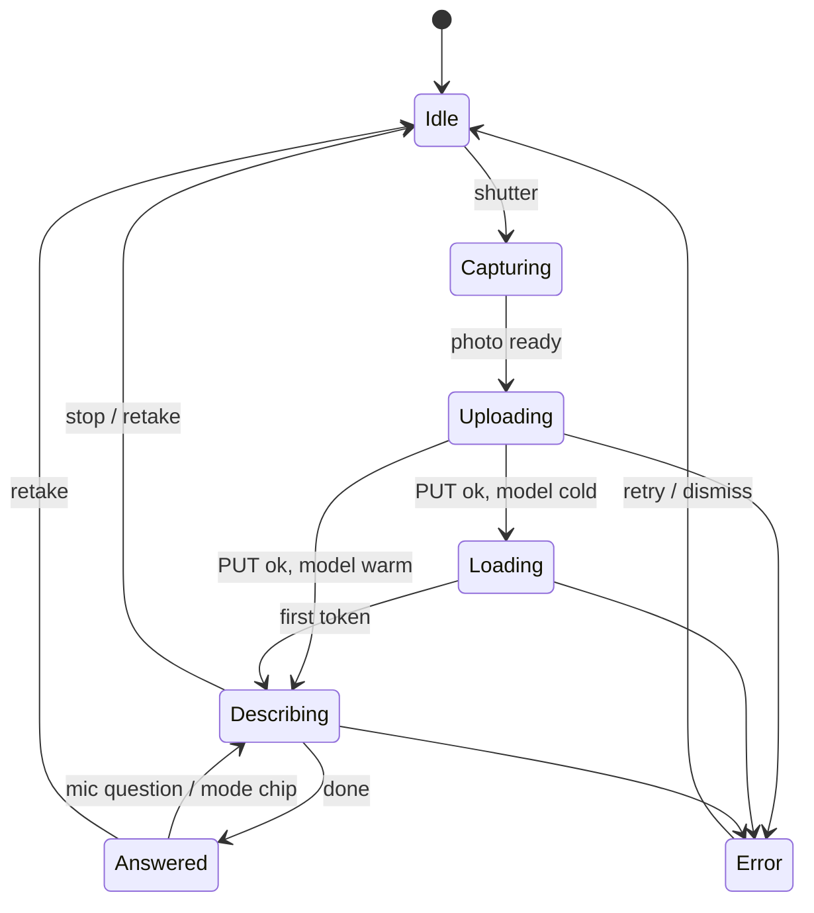

# 16 — Veda Mobile App (Android): design and UX

Status: **built through Stage 7 and verified on a real Android phone over home Wi-Fi (pairing, Look, Chat with approvals, Control, Settings). Questions by voice work once the phone has downloaded its offline English speech pack (the app offers a button). Stage 8 (polish) not started. Not ready for the Play Store.** Companion to `15-vision-mobile-design.md`, which defines the Pi side
(vision backend, pairing, permissions). Everything this app calls already exists and is tested; section 6 lists each
route and what the app does with each response.

Decisions already made: **Android only** for v1 · **Expo (React Native)** in `mobile/` · **English only** in v1 ·
speech-to-text and text-to-speech run **on the phone** · the phone talks to the Pi over the home Wi-Fi, never the internet.

## 1. What the app is for

Three jobs, in this order of importance:

1. **Look.** Point the camera at something, tap once, **hear** what it is. Follow up by voice: "what does the label say?"
2. **Talk to Veda.** Chat (typed or spoken) with the assistant on the Pi, and answer its approval requests.
3. **Control.** Glance at Veda's state and flip the few things that are safe from a phone: mute, tasks, reminders.

The app is **audio-first and one-handed**. The main user may be looking at the thing, not the screen, and may use
TalkBack. Every flow must work with the screen off the user's mind: speech tells the story, the screen confirms it.

### Principles

| # | Principle | What it means in the design |
|---|---|---|
| P1 | **One tap to the answer** | The app opens on the camera. Shutter → speech. No menus between. |
| P2 | **Never silent, never stuck** | Every wait has a spoken or visible state ("Looking…", "Still looking…"). Every failure says what to do. |
| P3 | **The phone holds almost nothing** | Token in the Android Keystore; photos in memory only; no chat history on the phone. |
| P4 | **The Pi decides** | The app hides what the paired permissions don't allow; the Pi enforces it anyway. |
| P5 | **Plain words** | No error codes on screen, no "503". Messages are one short sentence that says what happened and the next step. |

## 2. Users and situations

| Situation | What they need |
|---|---|
| Checking a label, sign, or bill | Fast, accurate reading of text (`Read text`) |
| "What is this?" around the house | A short spoken description, then follow-up questions |
| Someone who cannot see the screen | Everything spoken; big targets; TalkBack-friendly; haptics for state |
| Asking Veda something away from the Pi's microphone | Voice or typed chat, spoken reply |
| Veda needs permission to do something | A clear approve / deny with what it will do |
| Pi off or Wi-Fi gone | A calm explanation and a one-tap retry, not a spinner |

Out of scope for v1: iOS, Hindi/Telugu, video, saving photo history, working away from home Wi-Fi, background use,
notifications, tablets and landscape.

## 3. Information architecture

```
                         ┌──────────────┐
   first launch ───────► │  Welcome +   │──► Pair (scan QR / type code) ──┐
                         │  permissions │                                  │
                         └──────────────┘                                  ▼
                                                              ┌─────────────────────┐
   ┌───────────────┬──────────────────┬──────────────────┐    │   Main (3 tabs)     │
   │  👁  Look     │  💬  Veda        │  🎛  Control      │◄───┤  opens on Look      │
   │  (home)       │  (chat+approvals)│  (state + safe    │    └─────────────────────┘
   │               │                  │   switches)       │
   └───────────────┴──────────────────┴──────────────────┘
                          ⚙ Settings  (gear, top right of every tab)
```

- **Tabs are hidden by permission.** No `chat` permission → no Veda tab. No `control` → no Control tab. No `vision`
  → Look shows "This phone isn't allowed to use the camera feature" (re-pair on the Pi to change).
- **Settings** is a stack screen, not a tab: it is rarely used.
- Portrait only. System dark/light follows the phone; **dark is the designed default** (it's a camera app).

## 4. Screens

### 4.1 Welcome and pairing

First launch only. Goal: from install to a working paired phone in under a minute.

```
┌─────────────────────────────┐   ┌─────────────────────────────┐   ┌─────────────────────────────┐
│                             │   │  Scan the code on your Pi   │   │  Enter the code             │
│          ( Veda )           │   │ ┌─────────────────────────┐ │   │                             │
│                             │   │ │                         │ │   │  Pi address                 │
│   See and talk to Veda      │   │ │     camera viewfinder   │ │   │  [ 192.168.1.20        ]    │
│   from your phone.          │   │ │       [ QR frame ]      │ │   │  Port    [ 8000 ]           │
│                             │   │ │                         │ │   │  Code                       │
│   On your Pi, run:          │   │ └─────────────────────────┘ │   │  [ K7M2 - Q9XP ]            │
│     veda server --lan       │   │                             │   │  Phone name [ Pixel 8 ]     │
│     veda pair               │   │  Can't scan? Enter it by    │   │                             │
│                             │   │  hand ›                     │   │  [        Pair        ]     │
│  [   Scan the QR code   ]   │   │                             │   │                             │
│  Enter code by hand ›       │   │                             │   │                             │
└─────────────────────────────┘   └─────────────────────────────┘   └─────────────────────────────┘
```

- **Permissions are asked in context, once:** camera when the QR scanner opens; microphone the first time the user
  holds the mic button. Each ask is preceded by one line of why ("To read the pairing code" / "To hear your question").
- QR payload is `veda://pair?host=…&port=…&code=…`. A scan fills the form and pairs immediately.
- Code entry is forgiving: case-insensitive, dashes and spaces ignored (the Pi does the same).
- After success: shows "Paired with your Pi" with the permissions it got ("camera, chat, controls"; "approvals" only if
  granted), then lands on **Look**.
- Failures (all plain language): wrong or expired code ("That code didn't work. Codes last 2 minutes. Run `veda pair`
  again."), too many tries ("Too many wrong codes. Wait 5 minutes."), can't reach the Pi (see 4.6, with the checklist:
  same Wi-Fi? `veda server --lan`?).

### 4.2 Look (home)

```
 IDLE                              LOOKING                            ANSWERED
┌─────────────────────────────┐   ┌─────────────────────────────┐   ┌─────────────────────────────┐
│ ● Pi connected            ⚙ │   │ ● Pi connected            ⚙ │   │ ● Pi connected            ⚙ │
│                             │   │                             │   │ ┌─────────────────────────┐ │
│                             │   │      (frozen photo)         │   │ │   (photo, small)        │ │
│                             │   │                             │   │ └─────────────────────────┘ │
│     live camera preview     │   │                             │   │ A red apple and a blue mug  │
│                             │   │                             │   │ on a brown table. A label   │
│                             │   │   ◜ Looking…                │   │ reads "Best before 12/2027".│
│                             │   │                             │   │  ▔▔▔▔▔▔▔▔ (current sentence │
│                             │   │                             │   │          highlighted)       │
│ [Describe][Read text][Detail]│  │ [Describe][Read text][Detail]│  │ [Describe][Read text][Detail]│
│                             │   │                             │   │                             │
│  🎤        ( ◉ )        ⟲  │   │  🎤        ( ■ )         ⟲  │   │ 🎤 Ask about this  ( ◉ ) ⟲ │
│  ask      shutter   retake  │   │  ask       stop      retake │   │                             │
└─────────────────────────────┘   └─────────────────────────────┘   └─────────────────────────────┘
```

- **Shutter** (88 dp, bottom centre) captures, freezes the frame, and starts the flow. A haptic tick and a short
  shutter sound confirm it. While busy the shutter becomes **Stop**: it cancels speech and the request.
- **Mode chips** (Describe · Read text · Detailed) pick the prompt style (`brief`, `read_text`, `detailed`). The choice
  sticks. Changing mode **after** a photo re-asks the same photo (no re-upload) in the new style.
- **Ask (mic)**: press and hold, speak, release. The recognised words appear as a chip ("What does the label say?")
  and are sent as the question about the **same photo**. Typed fallback: tap the chip to edit, or long-press the mic
  area to open a keyboard field.
- **Retake** clears the photo and the answer and returns to the live preview.
- **Text under the photo** is the transcript of what is being spoken. The **sentence currently being spoken is
  highlighted**; tap any sentence to hear it again. Text is selectable and a Share/Copy action sits in the overflow.
- **Status chip** (top-left): green "Pi connected", amber "Waking the camera model…", red "Can't reach your Pi".
- Photos are **never saved** by the app unless the user enables "Save photos" in Settings (off by default).

#### Look: states and what the user hears



| State | Screen | Speech / sound / haptic |
|---|---|---|
| Capturing | frame freezes | shutter sound + haptic |
| Uploading | "Looking…" | after 1.2 s of waiting: soft "Looking." |
| Loading (cold model) | chip turns amber, "Waking up the camera model. First photo takes a little longer." | "Starting up. This takes a few seconds." once |
| Describing | text appears and is spoken sentence by sentence | speech starts at the first complete sentence |
| Slow (> 12 s with no text) | "Still looking…" | "Still looking." once; again at 30 s |
| Answered | full text, mic/chips enabled | soft done tone |
| Error | one-line message + the next step | short error tone + haptic, message spoken |

#### Look: behaviours that make it feel solid

- **Silent recovery from an expired photo.** The Pi keeps a photo for 5 minutes. The app also keeps its own resized JPEG in
  memory. If a follow-up returns "unknown or expired photo", the app re-uploads and re-asks without bothering the user.
- **Busy (429).** Someone else (or a previous request) is using the model. The app waits the `Retry-After` and retries
  once, saying "One moment." If still busy: "The camera model is busy. Try again in a few seconds."
- **Speech never overlaps itself.** A new photo or new question stops current speech first. Stop is instant.
- **Interrupting is natural.** Starting the mic stops speech. Tapping the shutter while speaking cancels the old request
  and takes a new photo.
- **Screen stays awake** while looking or speaking; released afterwards.
- **App backgrounded mid-answer:** speech and the request stop; on return the screen shows the answer so far and a
  "Ask again" button. No background service in v1.

### 4.3 Veda (chat)

```
┌─────────────────────────────┐   ┌─────────────────────────────┐
│ Veda                    ⚙   │   │ Veda                    ⚙   │
│ ┌─────────────────────────┐ │   │ ┌─────────────────────────┐ │
│ │ ⚠ Veda wants to send an │ │   │ │ ⛔ Auto-approve is on at │ │
│ │ email to Priya: "Running│ │   │ │ the Pi, so chat from the │ │
│ │ late".                  │ │   │ │ phone is paused.         │ │
│ │ [ Deny ]   [ Approve ]  │ │   │ └─────────────────────────┘ │
│ └─────────────────────────┘ │   │                             │
│  You: remind me to call mum │   │  (conversation dimmed)      │
│       at 6                  │   │                             │
│  Veda: Done. I'll remind    │   │                             │
│        you at 6 pm.         │   │                             │
│  You: what's on my calendar │   │                             │
│  Veda: ▍ (typing…)          │   │                             │
│                             │   │                             │
│ [ Type a message…     ] 🔊 🎤│   │ [ Paused                ] 🔊 🎤│
└─────────────────────────────┘   └─────────────────────────────┘
        approval banner                   auto-approve is on
```

- **Composer:** text field, mic (hold to talk), speaker toggle (speak replies aloud). The speaker defaults **on when
  the last input was spoken**, off when typed.
- **Replies stream in** as they are generated. Spoken sentence by sentence, same speech engine as Look.
- **Approvals banner** appears at the top the moment a request is pending. It is polled (every 2 s while a turn is
  running, 10 s otherwise). With the `approve` permission: **Approve / Deny** buttons, and a plain-language summary of
  the action. Without it: the same summary and "Approve it on the Pi" (no buttons that would only fail).
  A pending approval also **speaks and vibrates** if the app is in the foreground.
- **Auto-approve (yolo) on at the Pi:** the Pi refuses phone chat. The composer greys out with the explanation above.
  Control shows the same state. (Rationale: with auto-approve on, a phone could trigger actions that never reach an
  approval prompt.)
- **Long answers** are fine; the list auto-scrolls while streaming unless the user scrolled up.
- **Session:** the app sends no session id; the Pi derives one from its 30-minute activity gap. The phone shows the
  current conversation only; closing the app clears it from the screen (the Pi keeps its own history).
- Chat sends **only** the message. `system_context` and `from_voice` are ignored by the Pi for phones, so the app never
  sends them.

### 4.4 Control

A glanceable status page with a few safe switches. Cards appear only if the permission allows them.

```
┌─────────────────────────────┐
│ Control                 ⚙   │
│ ┌─ Veda ──────────────────┐ │
│ │ ● Online · 38 ms        │ │
│ │ Camera model: idle      │ │
│ │ Auto-approve: off       │ │
│ └─────────────────────────┘ │
│ ┌─ Microphone ────────────┐ │
│ │ Listening   [ Mute ]    │ │
│ │ (To unmute, use the Pi) │ │
│ └─────────────────────────┘ │
│ ┌─ Tasks ─────────────────┐ │
│ │ ☐ Call mum        6 pm  │ │
│ │ ☐ Buy milk              │ │
│ │ + Add a task            │ │
│ └─────────────────────────┘ │
│ ┌─ Reminders ─────────────┐ │
│ │ Next: Dentist, 4:30 pm  │ │
│ │ Heads-up: 15 min before │ │
│ └─────────────────────────┘ │
│ ┌─ Recent activity ───────┐ │
│ │ weather · 1.2 s         │ │
│ │ set_reminder · 0.4 s    │ │
│ └─────────────────────────┘ │
│  Persona · Proactivity ›    │
└─────────────────────────────┘
```

- **Mute only, never unmute.** A phone can close the Pi's microphone but cannot reopen it (a stolen token must not be
  able to turn the always-on mic on). The card says so in one line.
- **Tasks:** list, add, complete. **Reminders:** read-only status plus the lead-time setting.
- **Recent activity:** what the tool harness did, read-only.
- **Persona / proactivity:** two simple pickers on a sub-screen.
- Pull to refresh; auto-refresh every 10 s while visible.
- What the app will **never** show (the Pi refuses it for phones): shutdown, auto-approve switch, unmute, saved memory
  facts, speaker enrolment, Google sign-in, device management. These are done at the Pi's terminal.

### 4.5 Settings

| Section | Items |
|---|---|
| **Your Pi** | Address and port (editable), connection test, this phone's name and **device id**, permissions granted, **Forget this Pi** |
| **Voice** | Speech rate, pitch, voice (from installed English voices), "Use TalkBack instead of the app's voice" (auto when TalkBack is on) |
| **Look** | Default mode (Describe / Read text / Detailed), auto-speak on/off, "Save photos to gallery" (off), haptics, sounds |
| **Privacy** | "Photos are sent only to your Pi on your Wi-Fi and are never stored on the phone unless you turn on Save photos." Link to what the app stores |
| **About** | App version, Pi software version, "Copy diagnostics" (no tokens, no photos) |

**Forget this Pi** clears the token and settings on the phone and shows "To remove this phone completely, run
`veda devices revoke <id>` on your Pi" with the id and a copy button. (A phone cannot revoke itself: device management is
local to the Pi.)

### 4.6 Connection and error states

The status chip and a full-screen state cover every way the link can fail. Messages are spoken where speech is active.

| Situation (what the app sees) | Message | Action |
|---|---|---|
| No route / timeout / refused | "Can't reach your Pi. Is it on, and is this phone on the same Wi-Fi?" | **Retry**, **Change address** |
| 401 (token unknown or revoked) | "This phone was removed from Veda. Pair it again." | Clears token, opens Pair |
| 403 with "lacks the 'x' permission" | "This phone isn't allowed to do that. Change it with `veda pair` on the Pi." | Dismiss |
| 403 "remote access is disabled" | "Phone access is switched off on the Pi." | Dismiss |
| 403 auto-approve on (chat) | "Auto-approve is on at the Pi, so chat from the phone is paused." | Disables composer |
| 429 on pairing | "Too many wrong codes. Wait 5 minutes." | — |
| 429 on vision (busy) | "The camera model is busy. One moment." | Auto-retry once |
| 503 vision off | "Camera description is switched off on the Pi." | Dismiss |
| 503 not enough memory | "The Pi is short of memory right now. Try again in a minute." | Retry |
| 503 model not installed / failed | "The camera model isn't ready on the Pi." | Dismiss |
| 422 photo rejected | "I couldn't read that photo. Try again." | Retake |
| Stream ends without "done" | "The answer was cut off." | Ask again |

If the Pi's IP changes (DHCP) the app says so and offers **Change address**. A tip in Settings: give the Pi a fixed IP in
the router, or use its hostname.

## 5. Visual design

### Look and feel

Calm, dark, high-contrast, large. It should feel like a good camera app, not a chat app with a camera bolted on.

| Token | Dark (default) | Light | Use |
|---|---|---|---|
| `bg` | `#0E1116` | `#FFFFFF` | screen background |
| `surface` | `#171B22` | `#F3F5F8` | cards, composer, banners |
| `text` | `#E8EAED` | `#14181F` | primary text |
| `muted` | `#9AA3AE` | `#5A6472` | secondary text, hints |
| `accent` | `#F5A524` | `#B26A00` | shutter ring, highlights, primary buttons |
| `ok` | `#3DD68C` | `#127A4A` | connected |
| `warn` | `#F5A524` | `#B26A00` | waking, slow |
| `danger` | `#FF5D5D` | `#C42B2B` | errors, deny |

All text/background pairs meet WCAG AA (4.5:1); the accent is never the only carrier of meaning (icons and words
accompany colour).

- **Type:** system sans (Roboto), scales with the phone's font size. Answer text 20 sp; body 16 sp; labels 14 sp.
- **Spacing:** 4 dp grid; screen gutters 16 dp.
- **Targets:** at least 56 dp tall for buttons; shutter 88 dp; mic 64 dp; generous gaps so the wrong one is hard to hit.
- **Motion:** the shutter ring pulses slowly while looking (stops with reduced-motion setting). Text fades in per
  sentence. Nothing bounces.
- **Icons:** one outline icon set, 24 dp, always with a text label on the three main controls.

### Sound and haptics

| Event | Sound | Haptic |
|---|---|---|
| Capture | soft shutter click | light tick |
| Answer starts | none (the voice is the cue) | — |
| Answer done | short low tone | — |
| Approval needed | two-note chime + spoken summary | double pulse |
| Error | short descending tone | heavy tick |

All sounds are short, quiet, and can be turned off; haptics likewise. Spoken cues never repeat more than once per wait.

## 6. How the app talks to the Pi

One small API layer (`mobile/src/api/`), one place that adds the token, parses streams, and maps failures to the
messages in 4.6. Base URL is `http://<host>:<port>` from the pairing step. All requests carry
`Authorization: Bearer <token>` except pairing.

| Screen | Call | Notes |
|---|---|---|
| Pair | `POST /api/pair {code, device_name}` | → `{device_id, token, scopes}`; the token is shown once, store it at once |
| Any | `GET /api/health` | status chip, every 15 s while in the foreground |
| Look | `PUT /api/vision/images` (raw JPEG body) | → `{image_id, width, height}`; ≤ 1 MB |
| Look | `POST /api/vision/ask {image_id, question?, style, lang:"en"}` | SSE of JSON events (below) |
| Look | `GET /api/vision/status` | optional: show "model loaded / idle" in Settings |
| Veda | `POST /api/stream {message}` | SSE of plain text chunks, ends with `[DONE]` |
| Veda | `GET /api/approval/pending` | poll; `POST /api/approval/{id}/approve` or `/deny` need the `approve` permission |
| Control | `GET /api/status`, `/api/governance/audit/stats`, `/api/approval/yolo`, `/api/config/proactivity` | status card |
| Control | `GET /api/voice/status`, `/api/privacy/status`, `POST /api/privacy/mute` | microphone card (mute only) |
| Control | `GET/POST /api/tasks`, `POST /api/tasks/{id}/complete` | tasks card |
| Control | `GET /api/reminders/status`, `/api/reminders/recent`, `GET/PUT /api/reminders/config` | reminders card |
| Control | `GET /api/trace` | recent activity |
| Control | `GET/POST /api/persona`, `GET/POST /api/config/proactivity` | pickers |

### Streams

Two stream shapes, one parser:

- **Vision** events are JSON in `data:` lines: `{"type":"status","state":"loading"}`, `{"type":"token","text":"…"}`,
  `{"type":"done"}`, `{"type":"error","code":"…","message":"…"}`. The `error` event's `message` is already safe to show.
- **Chat** chunks are plain text in `data:` lines (a chunk may span several `data:` lines for line breaks); the stream ends
  with `[DONE]`.

React Native's default `fetch` does not stream a response body. Use `expo/fetch` (Expo SDK 52+) or `react-native-sse`
(XHR based; supports headers and POST). Pick one in M5a, behind the same `streamSse()` function, and test both stall and
cut-off behaviour. The parser must handle events split across network chunks and ignore keep-alive comments.

### Photo pipeline

1. Capture with the camera at quality 0.8.
2. Resize so the long edge is **768 px** and re-encode JPEG ~0.8 (about 100–200 KB) on the phone, off the UI thread.
3. Keep that JPEG in memory (for silent re-upload and follow-ups); `PUT` it.
4. On a new capture, retake, or after the app has been in the background for 5 minutes: drop it.

The Pi re-checks and re-shrinks anyway, strips camera and GPS data, and keeps the photo in its memory for 5 minutes.

## 7. Speech

| Piece | Choice | Rules |
|---|---|---|
| Speech out | `expo-speech` (Android TextToSpeech) | One **sentence queue**. Split on `. ! ?` and newlines; speak a sentence the moment it completes; flush a trailing fragment at `done`. `Stop` clears the queue. Per-utterance start/done events drive the highlight. |
| Speech in | `expo-speech-recognition` (community module; needs a dev build) | **On-device only** (`requiresOnDeviceRecognition`), locale `en-IN`. Check support at first use. If the offline English pack is missing: say so and show how to install it; offer the keyboard. Never fall back to cloud recognition silently. |
| TalkBack on | detect with `AccessibilityInfo` | Don't run the app's own TTS on top of TalkBack. Put the answer in a live region so TalkBack reads it; keep the highlight and controls. A Settings switch overrides. |
| Interruptions | audio focus | Pause for calls; stop speech when another app takes focus. |

Speech-recognition results are shown to the user before sending ("What does the label say?"), so a mishearing is
visible and editable. The microphone is only open while the button is held.

## 8. Accessibility

- Every control has a label and role; the **focus order** follows the visual order; the shutter is the first
  focusable item on Look.
- Status text is an **accessibility live region** (polite), so state changes are announced without stealing focus.
- Touch targets ≥ 48 dp (we use 56+); no gesture is required: every swipe or long-press has a button equivalent.
- Fonts scale to the largest system size without clipping (layouts use wrapping, not fixed heights).
- Respects reduce-motion, high-contrast, and bold-text settings.
- All sounds and haptics are optional; **nothing is conveyed by colour alone**.
- Manual TalkBack pass is an acceptance criterion for each milestone, not a final polish step.

## 9. Security and privacy on the phone

- Token, host, port, device id in the **Android Keystore** (`expo-secure-store`). Never in logs, crash reports,
  screenshots of diagnostics, or backups (`allowBackup` off).
- Plain HTTP is used on the home network (the Pi serves no TLS in v1). Android 9+ blocks cleartext by default, so the
  build sets `usesCleartextTraffic` (via `expo-build-properties`), and the app **refuses any host that is not a private
  address or a `.local` name** (10.x, 172.16–31.x, 192.168.x, 169.254.x, `localhost`/emulator `10.0.2.2`). It will never
  send the token to a public address. TLS pinning is a v2 item (see doc 15, R9).
- Photos: in memory and the app's cache folder only while in use; cleared per 6; saved to the gallery only if the user
  turns that on. No analytics, no third-party SDKs that phone home, no ads.
- Screenshots of the approval banner and chat are allowed (it's the user's own data); the token screen is not shown
  anywhere.
- A 401 from the Pi immediately wipes the stored token.

## 10. Project structure

```
mobile/
  app.json / app.config.ts       # name, package id, permissions, cleartext, backup off
  src/app/                       # expo-router screens (SDK 55+ puts routes in src/app, not app/)
    _layout.tsx                  # providers, theme, auth gate
    (pair)/index.tsx  scan.tsx  manual.tsx
    (tabs)/_layout.tsx           # tabs hidden by permission
    (tabs)/look.tsx  veda.tsx  control.tsx
    settings/index.tsx  persona.tsx
  src/
    api/       client.ts  stream.ts  errors.ts  endpoints/*.ts      # one place for auth, SSE, error mapping
    state/     auth.ts  settings.ts  look.ts  chat.ts  control.ts   # small stores (Zustand), no global soup
    speech/    tts.ts  sentenceQueue.ts  stt.ts  talkback.ts
    camera/    capture.ts  resize.ts
    ui/        theme.ts  Button.tsx  Chip.tsx  StatusChip.tsx  Banner.tsx  Card.tsx  ...
    features/  look/  chat/  control/  pairing/  approvals/
    util/      sse.ts  hostCheck.ts  qr.ts  time.ts
  __tests__/
  package.json  tsconfig.json (strict)  eslint  jest
```

Rules: screens contain layout only; each feature owns its state and talks to `src/api` only; `src/api` knows nothing
about React. Nothing in `src/` of the Pi repo depends on `mobile/`.

### Libraries (kept small)

Expo SDK 58 / React Native 0.88 (targets API 36) · expo-router · expo-camera (also reads the QR) · expo-image-manipulator ·
expo-secure-store · expo-speech · expo-speech-recognition · expo-haptics · expo-keep-awake · expo-build-properties ·
expo-av or expo-audio (earcons) · zustand · TypeScript strict · jest-expo + React Native Testing Library. No
UI-kit dependency: the screens are simple enough to keep the design tokens in our own components.

## 11. Testing

| Level | What | How |
|---|---|---|
| Unit | SSE parser (split chunks, keep-alives, malformed lines), sentence splitter, error mapper, host allow-list, QR parser, state machines for Look and pairing | Jest, no device |
| Component | each screen in each state of 4.2/4.6, with a fake API | React Native Testing Library |
| Contract | the app's API layer against the **real** Pi backend | a small `scripts/mock_pi.py` serves the real routes with the fake vision backend (the same one the Python route tests use), so the app is developed without the model |
| End to end | pair → photo → spoken answer on a real phone and a real Pi | manual checklist per milestone; Maestro flows for the repeatable parts |
| Accessibility | TalkBack walkthrough; font-scale 200%; reduce-motion | manual, each milestone |
| Failure drills | Pi off, Wi-Fi off mid-answer, token revoked mid-session, model busy, expired photo, auto-approve on | scripted against the mock Pi |

## 12. Build and run

- Needs a **development build** (not Expo Go) because of the speech-recognition module: `npx expo run:android`, with the
  Android SDK, USB debugging on the phone, and the phone on the same Wi-Fi as the laptop or Pi.
- Develop against `mock_pi.py` on the laptop; then the real Pi backend on the laptop (`veda server --lan`, vision
  enabled); then the Pi itself.
- Release: a signed APK/AAB built locally or with EAS; sideloaded for v1 (a personal-use app; no Play Store requirement).

### 12.1 Build notes (Stage 1: toolchain proven, first APK built)

**Build an APK:** `powershell -File mobile/scripts/build-android.ps1 -Variant release` writes
`mobile/apk/veda-release.apk` (35 MB, arm64 only, signed with the debug key, so fine for sideloading and not for the Play
Store). The first build took ~15 min; later ones reuse the cache. `-Arch all` builds every CPU type, `-Clean` regenerates
the native project after changing `app.json` plugins or permissions.

**One-time Windows setup this machine needed** (all done):

- **Long paths.** React Native's C++ build nests the full source path inside its own output path and goes far past
  Windows' 260-character limit even from the shortest folder (`C:/v`). Fix: (1) `LongPathsEnabled=1` in the registry (an
  administrator command), and (2) replace the ninja inside the SDK's CMake 3.22.1 (1.10.2, which rejects long paths) with
  ninja 1.13.2 (long-path support arrived in 1.12.0); the original is kept as `ninja-1.10.2.exe.bak`. The script also
  mirrors the project to `C:/Users/prave/dev/vm` to keep paths shorter.
- **Toolchain:** JDK 17 in `C:/Users/prave/dev/jdk-17`, Android SDK in `%LOCALAPPDATA%/Android/Sdk` (platform 36 plus the
  compile SDK 37 and NDK 27 that Gradle fetched itself), `JAVA_HOME` / `ANDROID_HOME` set for the user.
- **Not usable here:** building inside WSL2. The WSL service crashed repeatedly on this 16 GB machine (`E_UNEXPECTED`, plus
  one kernel out-of-memory kill) even with memory and CPU caps. The Linux toolchain left behind in WSL (`~/dev`,
  `~/android-sdk`, `~/vm`) can be deleted.
- **Gotchas:** `gradlew.bat` splits arguments at `=`, so never pass `-Pname=value` from PowerShell (the script edits
  `gradle.properties` instead); PowerShell reserves `$args`; Python text mode on Windows rewrites line endings to CRLF.

**Checked on the built APK:** package `com.vedaatlas.companion`, target SDK 36, `arm64-v8a`, backups off, predictive back
on, cleartext HTTP allowed (the app restricts it to private addresses in code), not debuggable, **16 KB page alignment OK**
(`zipalign -c -P 16`), v2 signature valid. Permissions in the first build: CAMERA, RECORD_AUDIO, VIBRATE, INTERNET,
ACCESS_NETWORK_STATE, plus USE_BIOMETRIC / USE_FINGERPRINT that `expo-secure-store` adds; those two are now blocked in
`app.json` and disappear from the next build.

**Version pins and checks:** `react-dom` must equal `react` (19.3.0) exactly; React Testing Library needs `test-renderer`;
ESLint is held at 9 for `eslint-config-expo`; TypeScript 6 needs `"types": ["jest"]` for test globals. `npm run check`
runs typecheck, lint and Jest; `npx expo-doctor` must report no issues. `npm audit` flags 5 high findings, all in Expo's
dev-server tooling (`@expo/cli`: node-forge, zod), none in the shipped app; the suggested fix would downgrade Expo to 44,
so it is left alone.

### 12.2 Stage 2: API layer and mock Pi (done)

**Code** (`mobile/src`): `util/hostCheck.ts` (only private addresses, `localhost` and `.local` names are ever contacted),
`util/qr.ts` (the `veda://pair?...` link), `api/sse.ts` (spec-compliant event parser, any chunking, UTF-8 safe),
`api/errors.ts` (every failure becomes an `ApiError` with a `kind` and a plain sentence; server codes and status numbers never
reach the user), `api/transport.ts` (the one network seam), `api/client.ts` (`VedaApi`: health, pair, upload photo, vision
status, `askVision`, `chatStream`, pending approvals, approve, deny).

**Behaviours worth knowing:** a stream cancelled by the caller ends quietly and closes the connection; a stream that ends
without `done` is `cutOff`; a silent stream times out (`streamStallMs`, 120 s by default so a cold model has time to wake up);
a busy model is `visionBusy` with the server's `Retry-After`; an expired photo is `photoExpired` so the app can upload it
again; chat sends only `{message}` (never prompt text or a voice flag).

**Mock Pi** (`scripts/mock_pi.py`): serves the Pi's real vision, device and approval routes and the real permission gate, with
a scripted model (cold start, word-by-word answers, scripted failures) and canned chat. Run it for app development:

    vedic-atlas-env/Scripts/python.exe scripts/mock_pi.py --host 0.0.0.0

It listens on port **8765**, not 8000: the real Veda server uses 8000, and on Windows a listener on `127.0.0.1:8000` beats one on
`0.0.0.0:8000` for local traffic, which sends the laptop's own `/mock/...` requests to the wrong program. It prints a pairing code and a `veda://pair` link. Flags: `--cold-seconds`, `--chunk-delay`, `--fail-after N`, `--memory-error`,
`--vision-off`, `--simulate-lan` (treat every request as a phone on the Wi-Fi: used by the tests). Chat: `hello`, `multi`,
`send an email` (creates a real pending approval). Local-only helpers: `GET /mock/state`, `POST /mock/code?approve=1`,
`POST /mock/revoke-all`, `POST /mock/yolo?on=1`.

**Tests:** `npm run check` = typecheck (app and contract tests, separately) + lint + 212 unit tests + 16 contract tests. The
contract tests start the mock as a real process and drive it with the real client over real HTTP (`npm run test:contract`);
`pytest tests/test_mock_pi.py` keeps the mock itself honest as the backend changes.

**Not yet verified (needs the Stage 4 APK on a phone):** that Android's `expo/fetch` streams the response incrementally and
honours `AbortSignal`, that it accepts a `Uint8Array` request body for the photo upload, and that `TextDecoder` streaming
behaves in Hermes. The Node tests prove the logic; only the device proves the runtime.

### 12.3 Stage 3: pairing and connection (done)

**Screens** (`mobile/src/app`, Expo Router; routes live in `src/app`): `(pair)/welcome` (what to run on the Pi, scan, type the
code, or try without a Pi), `(pair)/scan` (QR scanner with the camera-permission states), `(pair)/manual` (code, address,
port, phone name, with plain-language validation), `(app)/index` (a temporary connected screen: status chip, what this phone
may do, "Forget this Pi"; Stage 4 replaces it with the tabs). `Stack.Protected` moves the user between the two groups
automatically when the pairing state changes, so no screen navigates "into" the app by hand.

**State** (`src/state`): `connection.ts` is the one place that knows whether this phone is paired (`loading / unpaired /
paired / demo`), saves the pairing in the Android Keystore (`expo-secure-store`), and hands every screen a `PiApi`. A saved
pairing that is corrupt, or points off the home network, is wiped on load. A 401 from the Pi ("removed") forgets the pairing
and shows a notice once. A dead connection only marks the link as unreachable and keeps the pairing. `linkMonitor.ts`
checks `/api/health` every 15 s, only while the app is in front.

**Demo mode:** "Try without a Pi" gives the same interface with fixed example answers (`api/demo.ts`). Nothing is saved, nothing
is sent anywhere, and every screen labels it as examples.

**Tests:** 315 unit tests (state, link monitor, demo API, validation, components, the four screens with the router and camera
mocked, and a routing suite that boots the real route table) plus 20 contract tests, four of which pair through the real connection store against the mock Pi over real HTTP.

**Trying it on a phone (APK from `scripts/build-android.ps1`):**

1. On the laptop: `vedic-atlas-env/Scripts/python.exe scripts/mock_pi.py --host 0.0.0.0`. Windows asks whether to allow
   `python.exe` on private networks: allow it. The mock prints your address and a pairing code (valid 10 minutes).
2. Put the phone on the same Wi-Fi, install `mobile/apk/veda-release.apk` (allow installs from your file manager or browser).
3. Open Veda, tap **Scan the code on your Pi**, or **Enter the code by hand** (address, port and code as the mock printed them: port 8765).
4. Expected: the connected screen with "Pi connected" and the permissions. Stop the mock: the chip turns to "Can't reach your Pi"
   within about 15 s. Restart the mock and it recovers. In PowerShell run `Invoke-RestMethod -Method Post http://127.0.0.1:8765/mock/revoke-all`
   (plain `curl` is a PowerShell alias for something else; `curl.exe -X POST ...` also works), which
   removes the phone: the app returns to the welcome screen with "This phone was removed from Veda".

**Found on the first real phone (and fixed):** the first Stage 3 APK opened on "Unmatched Route / veda:///". The launch address
is `/`, and the only screen at `/` was inside the protected app group, so a fresh install had nowhere to land. Fix: `/` is now
`src/app/index.tsx`, a redirect to `/welcome` or `/home` by pairing state, and the connected screen moved to `(app)/home`. Why the
tests missed it: they rendered each screen alone and never the route table. `__tests__/routing.test.tsx` now boots the real
`src/app` tree with the real guard (launch as fresh, paired and demo; the guard both ways; pairing and removal flipping screens),
and was checked to fail with the original routes (9 failures, including "Unmatched Route"). Lesson for every later stage:
a new screen or route gets a routing test, not only a screen test.

**Not verified until it runs on a phone (still open after the first install):** the QR scanner on a real camera, the on-screen keyboard over the form, secure storage
on a real Keystore, the splash-screen timing, TalkBack reading order, the back gesture between screens, and that Android allows
plain HTTP to the laptop (the build sets `usesCleartextTraffic`; the manifest was checked, the behaviour was not).

### 12.4 Stage 4: the Look screen (done; verified on a phone)

What exists: the whole photo-to-speech loop, tested on the laptop against the mock Pi.

- **Session logic** (`features/look/lookStore.ts`): one state machine (idle, capturing, uploading, looking, answered, error). It cuts the streamed answer into sentences and hands each to the voice as soon as it is complete, so speech starts while the Pi is still writing. Spoken cues: "Looking." after 1.2 s, "Starting up. This takes a few seconds." when the model is loading, "Still looking." at 12 s and 30 s. Failures are spoken as well as shown.
- **Recovery without bothering the user:** if the Pi has forgotten the photo (it keeps them 5 minutes) the app sends it again once, silently. A busy model gets one retry after the Pi's Retry-After (capped at 10 s), with "One moment." A second failure is reported.
- **Stop and leave:** the shutter becomes Stop while working (cancels the request and the voice, keeps the words already said). Leaving the app mid-answer does the same and shows "Paused when you left the app." Retake discards the photo; photos are deleted from the phone as soon as they are sent or discarded.
- **Platform adapters:** `speech/expoSpeaker.ts` (Android text-to-speech, English), `camera/photoPipeline.ts` (long edge 768 px, JPEG 0.8, original deleted), `platform/feedback.ts` (vibration), keep-screen-on while working.
- **Screens:** `(app)/look.tsx` is now the home screen (live camera, Describe / Read text / Detailed chips, frozen photo, answer with the spoken sentence highlighted, Hear again, Copy, Retake, Try again). The connection card moved to `(app)/settings.tsx` behind the gear, with a Back button. Tabs (Look / Veda / Control) are deliberately not added yet: there is nothing behind the other two until Stages 6 and 7, so Look stays a single screen until then.
- **Tests:** `lookStore` (40), `LookView` (8), new routing cases for `/look` and `/settings`, and `__contract__/look.contract.test.ts` driving the session through the real client against the mock Pi. The mock gained `POST /mock/expire-images` to test the silent re-upload.

Not yet verified on a real phone: camera capture and the rotation of the resized JPEG, text-to-speech voice and gaplessness, `expo/fetch` streaming over Wi-Fi, vibration, keep-awake, the permission card after "Don't ask again", TalkBack. Test these with the new APK.

### 12.5 Stage 5: ask by voice, Home screen (done; verified on a phone)

- **Verified on the user's phone after Stage 4:** camera orientation, spoken answers, pairing with the real server over Wi-Fi.
- **Home screen added** (`(app)/home.tsx`), because the user had no way back from Look. The app opens on Home (Look, Settings); Look has "< Home", Settings has "Back". This replaces the bottom-tabs idea until Chat and Control exist (Stages 6 and 7), at which point they join Home. Look releases the camera and stops the voice whenever it is not the screen in front.
- **Ask by voice:** with a photo on screen a microphone button appears. Hold, speak, let go: the words appear as a question chip ("Listening..." while open) and are asked about the same photo. Speech to text is on the phone (`speech/expoRecognizer.ts`, English, on-device model when the phone has one). The phone's own voice is silenced before the microphone opens. Permission is asked the first time the button is held. Failures are shown in plain words (microphone not allowed, speech recognition unavailable, nothing heard).
- **The microphone bug, solved (2026-10-25):** the mic closed instantly on two phones because the phone had not downloaded its offline English speech pack, so the recognizer failed with `language-not-supported`. The app now says so in plain words and shows a "Download offline speech" button (`androidTriggerOfflineModelDownload`, one time, over Wi-Fi; no voice is sent). Along the way the banner got a timed trace of the recognizer's events, a short grace period before a background blip closes the mic, and a reason whenever the app itself closes the mic. Confirmed working on a phone after the download.
- **Typed fallback:** "Type a question" under the answer. **Tap any sentence** to hear it again.
- **Screen readers:** the microphone also works as a single activation (TalkBack action) for people who cannot hold a button.
- **Tests:** `lookMic` (store, screen), `expoRecognizer` (adapter with a mocked native module).

Not yet in the app, from the original design: shutter sound and done tone, retake/mic icons with labels (Retake is a text button), photo shrinking after the answer, overflow menu, tabs (see above), "Save photos" setting. These go to the polish stage unless you want any sooner.

### 12.6 Stage 6: chat with Veda and approvals (done; verified on a phone)

- **Chat** (`(app)/chat.tsx`, `features/chat/`): type a message, the reply streams into one bubble, auto-scrolling unless the user has scrolled up. A speaker switch reads replies aloud sentence by sentence (same voice as Look). Stop ends a reply and keeps what arrived. The conversation lives only in the app's memory (the Pi keeps its own history). No microphone in chat yet, because the Look microphone is an open issue.
- **Approvals:** when Veda wants to do something that needs a yes (for example send an email), a card appears at the top with the plain-language summary. Phones paired with approval permission get Approve and Deny; other phones see "Approve it on the Pi." The app looks for approvals every 2 s while a reply is being written and every 10 s otherwise, only while the chat screen is in front and the app is open. A new request vibrates and is spoken once.
- **Auto-approve on at the Pi:** the Pi refuses phone chat. The app takes that message back out of the conversation, greys the composer and says why.
- **Home** now shows Look and Chat only if this phone was given those permissions, and says so if it has none.
- **Tests:** `chatStore` (store, approvals, polling), `chatView`, routing cases for `/chat` and the permission-based buttons, and `__contract__/chat.contract.test.ts` (real client against the mock Pi: reply, line breaks, approval created by chat then approved, a non-approving phone refused, auto-approve pause and resume, polling).
- **Known gap:** the mic in Look (see memory notes) flickers closed on the Samsung S928B; fix scheduled last. Control (Stage 7) and polish (Stage 8) remain.

### 12.7 Stage 7: Control and Settings (done; verified on a phone)

**Control** (`(app)/control.tsx`, `features/control/`), shown on Home only to phones paired with the control permission:
- **Veda:** connection and how fast the Pi answered, the camera model (asleep, ready, working, off), and whether auto-approve is on (read-only, with a warning when it is).
- **Microphone:** listening or muted, and a **Mute** button. There is no unmute in the app and none that a phone could call: the Pi refuses the toggle route for phones (tested).
- **Tasks** (chat permission): tick to finish, add a new one. **Reminders:** next one, the heads-up time, and a field to change it (1 to 120 minutes, up to five, validated in the app and by the Pi). **Personality:** persona and "speaks up" level, changeable only with control permission. **Recent activity:** what Veda did and how long each took.
- Each card loads on its own, so one failing section never blanks the page; a card the Pi refuses to this phone is hidden. Refreshes every 10 s while open, pull down to refresh. Failed changes put the old value back and say why. Demo mode shows every card with example data.
- Dead rows noticed: the permission table lists `GET /api/status`, which does not exist on the real server, so Control uses `/api/health`, `/api/vision/status`, `/api/approval/yolo` and the others instead. (Worth removing that row from `device_scope_policy.py` later.)

**Settings** now has: **Your Pi** (pairing details, Test connection, Change address: the saved pairing is tried at the new address first and nothing is saved unless that Pi accepts it; a public address is refused), **Voice** (speed, pitch, Hear a sample; applies to Look and chat), **Look** (the mode it starts in, vibration), **Privacy** (plain explanation), **About** (version, Copy diagnostics, which never includes the pairing secret or photos), and Forget this Pi. Choices are saved on the phone (`state/preferences.ts`), and bad saved values fall back to defaults field by field.

Not built from the original design: choosing a specific voice, "use TalkBack instead of the app's voice", auto-speak on/off, sounds, "Save photos". These go to the polish stage if wanted.

**Tests:** `controlClient`, `controlStore`, `controlFormat`, `controlView`, `preferences`, `connectionAddress`, `diagnostics`, `settingsScreen`, routing cases for `/control`, `__contract__/control.contract.test.ts` (real client against the mock Pi's real permission gate), and six Python tests for the mock's new routes (`tests/test_mock_pi.py`), including that a phone cannot unmute, shut down, or switch auto-approve.

## 13. Milestones and acceptance

| # | Deliver | Done when |
|---|---|---|
| **M5a** | Project skeleton, theme, API layer, SSE parser, pairing screens, secure storage, host check, mock Pi script | A fresh install pairs with the mock Pi and with the real backend; a revoked token returns to Pair; unit tests green |
| **M5b** | Look: camera, resize, upload, streamed answer, sentence-queue speech, modes, retake, errors and loading states | Photo → spoken answer on a real phone; every row of 4.6 reachable and phrased right; TalkBack pass |
| **M5c** | Look follow-ups: mic (on-device), question chip, silent re-upload, busy retry, keep-awake | "What does the label say?" works by voice; expired-photo recovery verified by waiting 5+ minutes |
| **M6a** | Veda tab: streaming chat, speaker toggle, voice input, auto-approve state | Conversation works typed and spoken; yolo-on state shown and recovers when turned off |
| **M6b** | Approvals tray + Control screen | Approve/deny with the permission, view-only without; mute works and unmute is absent; tasks add/complete |
| **M7** | Settings, polish, sounds, diagnostics, release build, Pi run | Whole checklist passes against the real Pi with `VEDA_DEVICE=pi`; latency measured and recorded |

## 14. Risks

| Risk | Mitigation |
|---|---|
| First answer takes 10+ s on the Pi | Spoken "starting up" and "still looking" cues; first sentence spoken as soon as it exists; loading state explained |
| Offline English speech pack missing | Check at first use, plain-language install steps, keyboard fallback, never cloud |
| `expo-speech-recognition` is a community module | Wrapped behind `stt.ts`; typed input always works; verify behaviour on the target phone in M5c |
| Streaming over `fetch` differs by Expo SDK | `streamSse()` is one function with two implementations behind it; failure drills in M5a |
| Pi's IP changes | Clear message, Change address, tip for a fixed IP / hostname |
| TalkBack and the app's TTS talk over each other | Detect TalkBack; route speech through a live region |
| Plain HTTP on Wi-Fi | Private-address-only host check; documented; TLS pinning in v2 |
| Phone battery during camera + streaming | Screen-awake only while active; no background work |
| Scope creep into a second chat app | The Veda tab is a thin client of `/api/stream`; features that need new Pi routes wait for v2 |

## 15. Open questions

1. **App name and icon:** "Veda" alone, or something distinguishing it from the assistant on the Pi?
2. **Light theme:** ship it in v1, or dark only?
3. **Photo history:** v1 keeps none. Is a small on-phone history (last 10 answers, text only) wanted?
4. **Pi hostname:** will the Pi have a stable name (`veda.local`) or a reserved IP, so Change address is rare?
5. **Sounds:** use the system defaults, or short custom earcons (needs sourcing or recording)?
